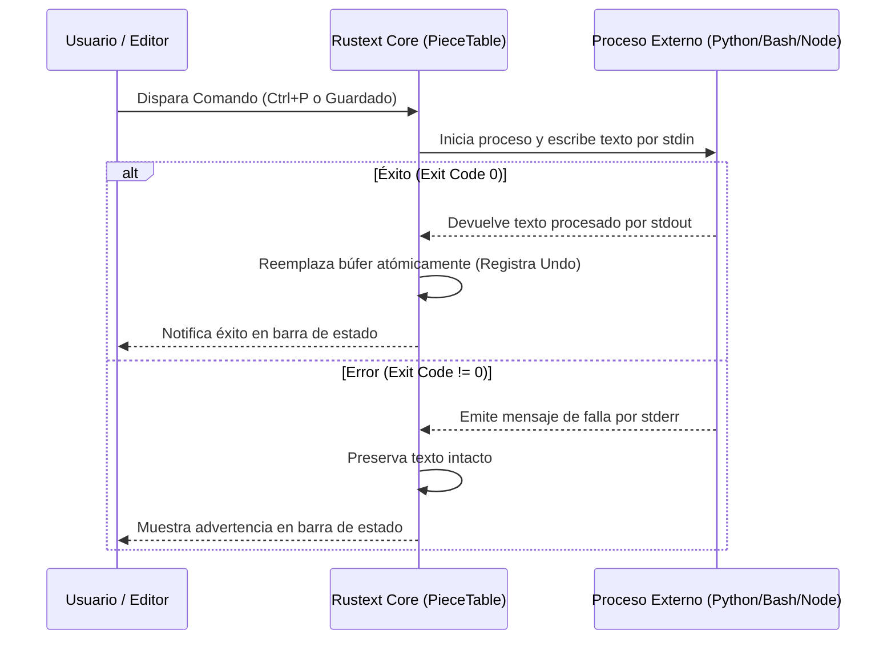

# 🎨 Manual de Creación de Temas y Extensiones de Rustext

[](Cargo.toml)
[](https://github.com/boleklolek/rustext/actions)
[](LICENSE)
[](src/)
[](Cargo.toml)
[](#)

Este manual proporciona una guía completa para desarrolladores y usuarios sobre cómo personalizar, diseñar y agregar nuevos **Temas Visuales** y desarrollar **Extensiones y Plugins** en **Rustext**.

---

## 📑 Tabla de Contenidos

1. [Arquitectura y Principios de Diseño](#1-arquitectura-y-principios-de-diseño)
2. [Guía de Temas Visuales (Themes)](#2-guía-de-temas-visuales-themes)
   - [2.1 Temas Oficiales Integrados](#21-temas-oficiales-integrados)
   - [2.2 Cómo Seleccionar y Cambiar Temas](#22-cómo-seleccionar-y-cambiar-temas)
   - [2.3 Recarga en Caliente (Hot Reloading) con config.ini](#23-recarga-en-caliente-hot-reloading-con-configini)
   - [2.4 Anatomía del Motor de Color (ARGB 32-bit y ANSI 256)](#24-anatomía-del-motor-de-color-argb-32-bit-y-ansi-256)
   - [2.5 Diccionario de Propiedades de ThemeColors](#25-diccionario-de-propiedades-de-themecolors)
   - [2.6 Creación de Temas de Usuario (.theme) ¡Sin Modificar el Código Fuente!](#26-creación-de-temas-de-usuario-theme-sin-modificar-el-código-fuente)
   - [2.7 Compilación de Temas Nativos en el Núcleo (Opcional para Desarrolladores)](#27-compilación-de-temas-nativos-en-el-núcleo-opcional-para-desarrolladores)
3. [Guía de Extensiones y Plugins](#3-guía-de-extensiones-y-plugins)
   - [3.1 Arquitectura de Subprocesos e IPC Políglota](#31-arquitectura-de-subprocesos-e-ipc-políglota)
   - [3.2 Ubicación de las Extensiones (Global y Workspace)](#32-ubicación-de-las-extensiones-global-y-workspace)
   - [3.3 Administrador Visual de Extensiones (Ctrl + Shift + X)](#33-administrador-visual-de-extensiones-ctrl--shift--x)
   - [3.4 Especificación del Manifiesto extension.conf](#34-especificación-del-manifiesto-extensionconf)
   - [3.5 Protocolo de Comunicación (stdin, stdout y stderr)](#35-protocolo-de-comunicación-stdin-stdout-y-stderr)
   - [3.6 Activación Automática al Guardar (on_save)](#36-activación-automática-al-guardar-on_save)
4. [Tutoriales Prácticos: Creando Extensiones Paso a Paso](#4-tutoriales-prácticos-creando-extensiones-paso-a-paso)
   - [Tutorial 1: Extensión en Python (Formateador y Validador JSON)](#tutorial-1-extensión-en-python-formateador-y-validador-json)
   - [Tutorial 2: Extensión en Bash / Shell (Cabecera de Licencia AGPLv3)](#tutorial-2-extensión-en-bash--shell-cabecera-de-licencia-agplv3)
   - [Tutorial 3: Extensión con Comando Unix Directo (Convertidor a Mayúsculas)](#tutorial-3-extensión-con-comando-unix-directo-convertidor-a-mayúsculas)
   - [Tutorial 4: Extensión en Node.js (Minificador y Ordenador de Claves)](#tutorial-4-extensión-en-nodejs-minificador-y-ordenador-de-claves)
   - [Tutorial 5: Plugin Nativo en Rust puro (Trait Plugin)](#tutorial-5-plugin-nativo-en-rust-puro-trait-plugin)
5. [Solución de Problemas y Buenas Prácticas](#5-solución-de-problemas-y-buenas-prácticas)
6. [Resumen de Atajos de Teclado](#6-resumen-de-atajos-de-teclado)

---

## 1. Arquitectura y Principios de Diseño

Rustext está construido bajo la premisa de **cero dependencias de terceros** y **máximo aislamiento de seguridad**:

* **Temas**: El renderizador de interfaz gráfica maneja un framebuffer ARGB lineal de 32 bits con corrección gamma sRGB IEC 61966-2-1 y antialiasing subpíxel. Los temas definen paletas estructuradas que alimentan el analizador léxico, los diálogos modales, las pestañas, los brackets arcoíris y los números de línea.
* **Extensiones**: A diferencia de editores basados en JavaScript o WebViews que ejecutan código de terceros en el mismo hilo del editor arriesgando bloqueos o consumos masivos de memoria, Rustext utiliza un **modelo de subprocesos aislados (IPC)**.
  * Una extensión puede escribirse en **cualquier lenguaje** (Python, Bash, Node.js, C, Rust binario, Go, Ruby, etc.).
  * Si la extensión falla, arroja un error o se bloquea, el editor permanece **100% estable, protegido y responsivo**.
  * No expone la memoria interna del editor (`CWE-829 / CWE-94` mitigados).

---

## 2. Guía de Temas Visuales (Themes)

### 2.1 Temas Oficiales Integrados

Rustext incluye de fábrica 8 temas visuales optimizados:

| Identificador | Nombre en Interfaz | Estilo |
| :--- | :--- | :--- |
| `tokyo-night` | **Tokyo Night** | Azul profundo, violetas y cian neón (inspirado en Folke Tokyo Night) |
| `catppuccin` | **Catppuccin Mocha** | Tonos pastel suaves sobre fondo chocolate oscuro (#1e1e2e) |
| `onedark` | **One Dark Pro** | Estilo clásico Atom / One Dark con balance equilibrado |
| `dark` | **Modern Dark** | Oscuro contemporáneo minimalista (#1e1e1e) |
| `monokai` | **Monokai Classic** | Alto contraste con amarillo canario, magenta y verde lima |
| `solarized` | **Solarized Dark** | Clásico azul verdoso (#002b36) con contrastes matemáticos Ethan Schoonover |
| `light` | **Claro (GitHub Light)** | Fondo blanco puro y nítido para entornos muy iluminados |
| `dracula` | **Dracula Official** | Fondo gótico (#282A36) con acentos púrpura vampírico, verde y cian |

#### Archivos Oficiales Modularizados (`assets/themes/`)

Todos los temas oficiales de Rustext están modularizados y disponibles como archivos independientes en el directorio [`assets/themes/`](file:///home/bolek/Proyectos/rustext/assets/themes/) del repositorio:

* [`assets/themes/tokyo-night.theme`](file:///home/bolek/Proyectos/rustext/assets/themes/tokyo-night.theme)
* [`assets/themes/catppuccin-mocha.theme`](file:///home/bolek/Proyectos/rustext/assets/themes/catppuccin-mocha.theme)
* [`assets/themes/one-dark.theme`](file:///home/bolek/Proyectos/rustext/assets/themes/one-dark.theme)
* [`assets/themes/modern-dark.theme`](file:///home/bolek/Proyectos/rustext/assets/themes/modern-dark.theme)
* [`assets/themes/monokai.theme`](file:///home/bolek/Proyectos/rustext/assets/themes/monokai.theme)
* [`assets/themes/solarized-dark.theme`](file:///home/bolek/Proyectos/rustext/assets/themes/solarized-dark.theme)
* [`assets/themes/light.theme`](file:///home/bolek/Proyectos/rustext/assets/themes/light.theme)
* [`assets/themes/dracula.theme`](file:///home/bolek/Proyectos/rustext/assets/themes/dracula.theme)

---

### 2.2 Cómo Seleccionar y Cambiar Temas

Existen tres formas directas de cambiar el tema:

1. **Paleta de Comandos (`Ctrl + P`)**:
   * Presiona `Ctrl + P`.
   * Escribe `Tema:` y usa las flechas arriba/abajo para previsualizar y `Enter` para aplicar.
2. **Barra de Menús**:
   * Haz clic en **Preferencias > Tema** y elige la paleta deseada.
3. **Archivo de Configuración (`config.ini`)**:
   * Modifica la variable `name` en la sección `[theme]` de `config.ini`.

---

### 2.3 Recarga en Caliente (Hot Reloading) con config.ini

El archivo de configuración principal se ubica en:
* **Linux / macOS**: `~/.config/rustext/config.ini`
* **Windows**: `%APPDATA%\rustext\config.ini`

Para cambiar el tema permanentemente, edita la sección `[theme]`:

```ini
; ==============================================================================
; Configuración de Tema Visual de Rustext
; ==============================================================================
[theme]
; Opciones disponibles: tokyo-night, catppuccin, onedark, dark, monokai, solarized, light, dracula, o tu propio <nombre>.theme
name = catppuccin
```

En cuanto guardas el archivo en disco, el vigilante de configuración de Rustext detecta el cambio y redibuja la ventana instantáneamente sin tener que cerrar ni reiniciar el editor.

---

### 2.4 Anatomía del Motor de Color (ARGB 32-bit y ANSI 256)

Rustext renderiza el color en dos capas:
1. **Desktop GUI**: Cada color es un entero sin signo de 32 bits (`u32`) con formato `0x00RRGGBB`. Por ejemplo, `0x001A1B26` representa Rojo=`0x1A`, Verde=`0x1B`, Azul=`0x26`.
2. **Terminal TUI**: Cada color se define mediante secuencias de escape ANSI directas (16 o 256 colores) en [`src/ui/theme.rs`](file:///home/bolek/Proyectos/rustext/src/ui/theme.rs).

---

### 2.5 Diccionario de Propiedades de ThemeColors

En [`src/gfx/renderer.rs`](file:///home/bolek/Proyectos/rustext/src/gfx/renderer.rs), la estructura `ThemeColors` contiene los siguientes slots de color:

#### Colores de Estructura e Interfaz General
* `background`: Fondo principal del área de edición.
* `gutter_bg`: Fondo de la columna de números de línea.
* `gutter_fg`: Color de los números de línea inactivos.
* `gutter_border`: Línea divisoria vertical entre el gutter y el código.
* `tab_bar_bg`: Fondo de la barra horizontal de pestañas.
* `tab_active_bg`: Fondo de la pestaña del archivo actualmente visible.
* `tab_inactive_bg`: Fondo de pestañas en segundo plano.
* `tab_active_fg`: Color del texto de la pestaña activa.
* `tab_inactive_fg`: Color del texto de pestañas inactivas.
* `status_bar_bg`: Fondo de la barra de estado inferior.
* `status_bar_fg`: Color del texto informativo de la barra de estado.
* `selection_bg`: Fondo del texto seleccionado por el cursor.
* `cursor`: Color del cursor / caret (parpadeo suave o bloque).
* `accent`: Color de acento para bordes activos, botones y foco principal.

#### Diálogos Modales y Controles
* `modal_bg`: Fondo de ventanas flotantes (Paleta de comandos, Gestor de extensiones).
* `modal_header_bg`: Fondo de la barra de título modal.
* `modal_border`: Borde perimetral del modal.
* `input_bg`: Fondo de los campos de texto de entrada interactiva.
* `input_border`: Borde de los campos de texto activos.
* `button_bg` / `button_hover_bg` / `button_fg`: Colores de botones interactivos.
* `chip_bg` / `chip_fg`: Píldoras de badges y etiquetas.

#### Barras de Desplazamiento y Ayudas Visuales
* `scrollbar_bg`: Fondo del canal de la barra de desplazamiento.
* `scrollbar_border`: Separador visual del scrollbar.
* `scrollbar_thumb`: Color del pulgar de la barra de desplazamiento en reposo.
* `scrollbar_thumb_hover`: Color del pulgar al pasar el ratón.
* `scrollbar_thumb_active`: Color del pulgar al arrastrar.
* `current_line_bg`: Resaltado de la línea donde se encuentra el cursor.
* `ruler_color`: Líneas guía de columna (ej. columnas 80 y 120).
* `sticky_header_bg`: Fondo de la cabecera adhesiva (Sticky Scroll).

#### Resaltado de Sintaxis
* `syntax_keyword`: Palabras reservadas (`fn`, `let`, `mut`, `if`, `pub`, `struct`, etc.).
* `syntax_type`: Tipos de datos (`u32`, `String`, `Option`, `bool`, etc.).
* `syntax_string`: Literales de texto (`"hola mundo"`).
* `syntax_number`: Literales numéricos (`42`, `3.14`, `0xFF`).
* `syntax_comment`: Comentarios (`// ...`, `/* ... */`).
* `syntax_operator`: Operadores matemáticos y lógicos (`+`, `-`, `=`, `&&`, `|`).
* `syntax_punctuation`: Puntos, comas, dos puntos y punto y coma.
* `syntax_plain`: Texto estándar e identificadores.
* `syntax_function`: Nombres de funciones al declararse o invocarse.
* `syntax_method`: Métodos de estructuras y objetos.
* `syntax_struct`: Nombres de estructuras y clases.
* `syntax_trait`: Interfaces y traits.
* `syntax_macro`: Macros (`println!`, `vec!`, etc.).
* `syntax_parameter`: Parámetros de funciones.
* `syntax_constant`: Constantes en mayúsculas (`MAX_SIZE`).
* `syntax_field`: Campos de estructuras (`objeto.campo`).

#### Arcoíris de Paréntesis (Bracket Pair Colorization)
* `bracket_0`: Nivel de anidamiento 0 (`()`, `{}`, `[]`).
* `bracket_1`: Nivel de anidamiento 1.
* `bracket_2`: Nivel de anidamiento 2.

---

---

### 2.6 Creación de Temas de Usuario (`.theme`) ¡Sin Modificar el Código Fuente!

> [!IMPORTANT]
> **¡No necesitas editar el código fuente de Rustext ni recompilar el editor!**
> Rustext incluye un cargador dinámico de temas que lee archivos de texto declarativos `.theme` e `.ini`. Puedes definir tantas paletas como quieras simplemente guardando un archivo en tu carpeta de usuario o en tu proyecto.

#### Dónde guardar tus temas personalizados:
1. **Global de usuario**:
   * Linux / macOS: `~/.rustext/themes/<nombre>.theme` (o `~/.config/rustext/themes/<nombre>.theme`)
   * Windows: `%USERPROFILE%\.rustext\themes\<nombre>.theme`
2. **Local de tu proyecto (Workspace)**:
   * `./.rustext/themes/<nombre>.theme` (ideal para incluir el tema oficial del proyecto en el repositorio Git).

Al arrancar por primera vez, si el directorio `~/.rustext/themes/` está vacío o no existe, Rustext crea la carpeta y **auto-despliega las 8 plantillas oficiales completas**:
* `tokyo-night.theme`
* `catppuccin-mocha.theme`
* `one-dark.theme`
* `modern-dark.theme`
* `monokai.theme`
* `solarized-dark.theme`
* `light.theme`
* `dracula.theme`

Esto te permite abrir cualquiera de estos archivos, ajustar un color específico y ver el resultado de inmediato.

#### Orden de Búsqueda y Prioridad de Anulación (Override)
Cuando Rustext solicita un tema (por ejemplo `tokyo-night`, `dracula` o uno nuevo como `nord`):
1. **Espacio de trabajo local (`./.rustext/themes/<nombre>.theme`)**: Máxima prioridad. Sobrescribe cualquier otra definición.
2. **Carpeta de usuario (`~/.rustext/themes/<nombre>.theme`)**: Segunda prioridad. Permite al usuario personalizar cualquier tema para todas sus sesiones.
3. **Temas compilados en el binario**: Respaldo nativo infalible embebido en el ejecutable si no existe ningún archivo en disco.

> [!TIP]
> **Personalización sin tocar código**: Si deseas cambiar el color de fondo o el acento del tema oficial `tokyo-night`, basta con editar `~/.rustext/themes/tokyo-night.theme`. Rustext dará prioridad a tu archivo en disco sin alterar el código fuente de Rust.

#### Formato de un archivo `.theme`
Un archivo de tema utiliza sintaxis INI estándar con colores en formato hexadecimal flexible:
* `#RRGGBB` o `0xRRGGBB` (ej. `#282A36` o `0x282A36`)
* `#RGB` shorthand (ej. `#F80` expande a `#FF8800`)
* Comentarios de línea o inline iniciados por `;` o un espacio seguido de `#` (ej. `background = #282A36 # Comentario`)
* Los colores omitidos toman automáticamente los valores de respaldo del tema base (`type = dark` o `type = light`).

Ejemplo de `~/.rustext/themes/dracula.theme`:

```ini
# ==============================================================================
# Rustext Theme: Dracula
# Ubicación: ~/.rustext/themes/dracula.theme
# ==============================================================================
[meta]
id = dracula
name = Dracula
author = Dracula Theme Team
type = dark   ; 'dark' o 'light' (define los colores de respaldo)

[ui]
background = #282A36
gutter_bg = #21222C
gutter_fg = #6272A4
gutter_border = #191A21
tab_bar_bg = #191A21
tab_active_bg = #282A36
tab_inactive_bg = #21222C
tab_active_fg = #F8F8F2
tab_inactive_fg = #6272A4
status_bar_bg = #21222C
status_bar_fg = #F8F8F2
selection_bg = #44475A
cursor = #F8F8F0
accent = #BD93F9
current_line_bg = #44475A
ruler_color = #44475A
sticky_header_bg = #21222C

# Modales, diálogos y botones
modal_bg = #282A36
modal_header_bg = #21222C
modal_border = #BD93F9
input_bg = #191A21
input_border = #BD93F9
button_bg = #44475A
button_hover_bg = #6272A4
button_fg = #F8F8F2
chip_bg = #44475A
chip_fg = #BD93F9

# Barra de desplazamiento
scrollbar_bg = #282A36
scrollbar_border = #21222C
scrollbar_thumb = #44475A
scrollbar_thumb_hover = #6272A4
scrollbar_thumb_active = #BD93F9

[syntax]
keyword = #FF79C6
type = #8BE9FD
string = #F1FA8C
number = #BD93F9
comment = #6272A4
operator = #FF79C6
punctuation = #F8F8F2
plain = #F8F8F2
function = #50FA7B
method = #50FA7B
struct = #8BE9FD
trait = #50FA7B
macro = #FF79C6
parameter = #FFB86C
constant = #BD93F9
field = #F8F8F2

[brackets]
bracket_0 = #BD93F9
bracket_1 = #FF79C6
bracket_2 = #8BE9FD
```

#### Cómo activar tu tema personalizado:
1. **Desde `config.ini`**:
   Establece el ID o nombre del archivo en `~/.config/rustext/config.ini`:
   ```ini
   [theme]
   name = dracula
   ```
   En cuanto guardas el archivo, Rustext lo carga en caliente de forma instantánea.
2. **Desde la Paleta de Comandos (`Ctrl + P`)**:
   Rustext descubre automáticamente todos los temas de tu carpeta `~/.rustext/themes/`.
   Presiona `Ctrl + P`, escribe `Tema:` y verás tus temas listados automáticamente (ej. `Tema: Dracula (Personalizado)`).

---

### 2.7 Compilación de Temas Nativos en el Núcleo (Opcional para Desarrolladores)

Si eres colaborador del proyecto y deseas que una paleta forme parte permanente de los temas oficiales integrados en el binario sin depender de archivos en disco:

1. Agrega el método constructor en `src/gfx/renderer.rs` dentro de `ThemeColors` (ej. `pub fn mi_tema() -> Self`).
2. Añade el alias en `ThemeColors::by_name()`.
3. Registra la variante en el enum `EditorTheme` en `src/editor/config.rs`.
4. Añade el elemento al menú en `src/editor/menu.rs` y a la lista de comandos base en `src/ui/prompt.rs`.


---

## 3. Guía de Extensiones y Plugins

### 3.1 Arquitectura de Subprocesos e IPC Políglota

Rustext no requiere Node.js, v8 ni un intérprete embebido para ejecutar extensiones. Utiliza el estándar del sistema operativo:
* Al ejecutar una extensión, Rustext inicia el subproceso correspondiente (`std::process::Command`).
* Envía el texto actual del búfer a través de la tubería estándar `stdin`.
* Lee el resultado limpio a través de `stdout`.
* Si el proceso retorna código de éxito (`0`), el búfer se actualiza en memoria atómicamente creando un punto en el historial de **Deshacer (Undo) / Rehacer (Redo)**.
* Si el proceso retorna error (`stderr`), Rustext muestra el mensaje en la barra de estado y **no toca tu archivo**, garantizando total seguridad.



---

### 3.2 Ubicación de las Extensiones (Global y Workspace)

Rustext escanea dos niveles de directorios:
1. **Extensiones Globales de Usuario**:
   * Linux / macOS: `~/.rustext/extensions/`
   * Windows: `%USERPROFILE%\.rustext\extensions\`
2. **Extensiones del Proyecto (Workspace Local)**:
   * `./.rustext/extensions/` dentro de la carpeta raíz de tu proyecto abierto.

> [!TIP]
> Puedes subir la carpeta `.rustext/extensions/` de tu proyecto a tu repositorio Git para que todo tu equipo comparta automáticamente las mismas herramientas de formateo y scripts sin configuración manual.

---

### 3.3 Administrador Visual de Extensiones (Ctrl + Shift + X)

Rustext incluye un gestor gráfico integrado para administrar tus herramientas:

* **Atajo**: Presiona `Ctrl + Shift + X` (o ve al menú **Extensiones > Administrador de Extensiones...**).
* **Teclas rápidas dentro del diálogo**:
  * `↑` / `↓`: Navegar entre las extensiones instaladas.
  * `Espacio`: **Activar / Desactivar** la extensión seleccionada. (El cambio se guarda inmediatamente en `extension.conf`).
  * `R`: **Recargar** todas las extensiones de disco en caliente.
  * `N`: **Crear una Extensión de Ejemplo** automáticamente en tu carpeta de usuario.
  * `Esc`: Cerrar la ventana modal.

---

### 3.4 Especificación del Manifiesto extension.conf

Cada extensión debe residir en su propia carpeta y contener un archivo llamado `extension.conf`.

#### Estructura de Claves Disponibles:

```ini
# Identificador único de la extensión (sin espacios, alfanumérico)
id = mi_extension

# Nombre legible que aparecerá en el Administrador de Extensiones
name = Mi Herramienta Personalizada

# Versión en formato semántico
version = 1.0.0

# Autor o equipo creador
author = Desarrollador

# Breve descripción de la funcionalidad
description = Transforma y limpia el código del búfer

# Estado inicial (true = habilitada, false = desactivada)
enabled = true

# Comandos expuestos a la Paleta de Comandos (Ctrl+P)
# Sintaxis: id_comando:Etiqueta a mostrar en el menú
commands = ejecutar_limpieza:Limpiar Código Fuente

# Ejecutable del sistema a invocar (python3, sh, node, sed, etc.)
exec = python3

# Argumentos que se pasarán al ejecutable (separados por espacio)
args = run.py

# Si se debe ejecutar automáticamente cada vez que se guarda el archivo (Ctrl+S)
on_save = false
```

#### Detección Automática de Scripts (Convenciones)
Si no especificas la clave `exec`, Rustext buscará automáticamente dentro de la carpeta de la extensión cualquiera de los siguientes archivos en orden de prioridad:
* `run.py` o `main.py`: Se ejecutará automáticamente con `python3 <script>`.
* `run.sh` o `extension.sh`: Se ejecutará automáticamente con `sh <script>`.
* `run.bat` o `run.cmd`: Se ejecutará en Windows.

---

### 3.5 Protocolo de Comunicación (stdin, stdout y stderr)

1. **Entrada (`stdin`)**:
   El subproceso recibe a través de la entrada estándar la totalidad del texto del búfer actual (en codificación UTF-8 pura).
2. **Salida Estándar (`stdout`)**:
   Todo lo que el proceso escriba en `stdout` será tomado como el nuevo texto para el editor.
3. **Salida de Error (`stderr`)**:
   Si tu script encuentra un error y termina con código de salida distinto de `0` (ej. `sys.exit(1)` en Python o `exit 1` en Bash), lo que escribas en `stderr` se presentará como notificación de error en la barra de estado de Rustext, y el documento no sufrirá cambios.

---

### 3.6 Activación Automática al Guardar (on_save)

Al configurar `on_save = true` en `extension.conf`:
* Cada vez que guardas un archivo con `Ctrl + S`, Rustext pasa el contenido por el proceso antes de escribir a disco.
* Si el proceso devuelve cambios, el archivo se formatea automáticamente en vivo.
* Ideal para formateadores como `black`, `rustfmt`, `prettier`, `clang-format` o limpiadores de espacios.

---

## 4. Tutoriales Prácticos: Creando Extensiones Paso a Paso

### Tutorial 1: Extensión en Python (Formateador y Validador JSON)

Vamos a crear una extensión que tome un archivo JSON sucio o sin formato y lo deje perfectamente indentado.

1. **Crear el directorio**:
   ```bash
   mkdir -p ~/.rustext/extensions/formateador_json
   ```

2. **Crear el manifiesto** `~/.rustext/extensions/formateador_json/extension.conf`:
   ```ini
   id = formateador_json
   name = Formateador JSON Elegante
   version = 1.0.0
   author = Rustext Developer
   description = Indenta y ordena archivos JSON usando Python estándar
   enabled = true
   commands = format_json:Formatear JSON Completo
   exec = python3
   args = run.py
   on_save = false
   ```

3. **Crear el script** `~/.rustext/extensions/formateador_json/run.py`:
   ```python
   #!/usr/bin/env python3
   import sys
   import json

   def main():
       # Leer el contenido completo del editor desde stdin
       entrada = sys.stdin.read()
       
       if not entrada.strip():
           # Si el archivo está vacío, devolverlo intacto
           sys.stdout.write(entrada)
           return

       try:
           datos = json.loads(entrada)
           # Formatear con 2 espacios y preservar caracteres UTF-8
           salida = json.dumps(datos, indent=2, ensure_ascii=False) + "\n"
           sys.stdout.write(salida)
       except json.JSONDecodeError as err:
           # Rustext mostrará este mensaje en la barra de estado
           sys.stderr.write(f"Error en JSON: línea {err.lineno}, col {err.colno}: {err.msg}")
           sys.exit(1)

   if __name__ == "__main__":
       main()
   ```

4. **Probar la extensión**:
   * En Rustext, presiona `Ctrl + Shift + X` y luego pulsa `R` (para recargar).
   * Verás "Formateador JSON Elegante" en la lista de extensiones.
   * Abre un archivo JSON, presiona `Ctrl + P`, escribe `[Ext] Formatear JSON Completo` y pulsa `Enter`.

---

### Tutorial 2: Extensión en Bash / Shell (Cabecera de Licencia AGPLv3)

Extensión que inserta una cabecera de derechos de autor y licencia al inicio de tu archivo:

1. **Crear la carpeta**:
   ```bash
   mkdir -p ~/.rustext/extensions/insertar_licencia
   ```

2. **Crear el manifiesto** `~/.rustext/extensions/insertar_licencia/extension.conf`:
   ```ini
   id = insertar_licencia
   name = Añadir Cabecera de Licencia
   version = 1.0.0
   author = Mi Empresa
   description = Inserta la cabecera AGPLv3 al inicio del archivo actual
   enabled = true
   commands = add_lic:Insertar Cabecera AGPLv3
   exec = sh
   args = run.sh
   on_save = false
   ```

3. **Crear el script** `~/.rustext/extensions/insertar_licencia/run.sh`:
   ```bash
   #!/bin/sh
   AÑO=$(date +%Y)
   
   # Imprimir cabecera de licencia
   cat << EOF
   // =============================================================================
   // Copyright (c) $AÑO. Todos los derechos reservados.
   // Distribuido bajo los términos de la Licencia GNU AGPLv3.
   // =============================================================================

   EOF
   
   # Concatenar el contenido original del archivo
   cat -
   ```

4. **Dar permisos de ejecución**:
   ```bash
   chmod +x ~/.rustext/extensions/insertar_licencia/run.sh
   ```

---

### Tutorial 3: Extensión con Comando Unix Directo (Convertidor a Mayúsculas)

Puedes utilizar cualquier utilidad estándar de la línea de comandos sin necesidad de escribir scripts intermedios:

`~/.rustext/extensions/mayusculas/extension.conf`:
```ini
id = mayusculas
name = Transformar a Mayúsculas
version = 1.0.0
author = Rustext
description = Convierte todo el texto del archivo a mayúsculas usando tr
enabled = true
commands = to_upper:Convertir Todo a Mayúsculas
exec = tr
args = [:lower:] [:upper:]
on_save = false
```

---

### Tutorial 4: Extensión en Node.js (Minificador y Ordenador de Claves)

`~/.rustext/extensions/node_tools/extension.conf`:
```ini
id = node_tools
name = Limpiador Node.js
version = 1.0.0
author = JavaScript Team
description = Ordena claves alfabéticamente en objetos JSON
enabled = true
commands = sort_keys:Ordenar Claves Alfabéticamente
exec = node
args = index.js
on_save = false
```

`~/.rustext/extensions/node_tools/index.js`:
```javascript
const fs = require('fs');

const input = fs.readFileSync(0, 'utf-8');

try {
  const obj = JSON.parse(input);
  const sorted = Object.keys(obj).sort().reduce((acc, key) => {
    acc[key] = obj[key];
    return acc;
  }, {});
  process.stdout.write(JSON.stringify(sorted, null, 2) + '\n');
} catch (e) {
  process.stderr.write('Error al procesar: ' + e.message);
  process.exit(1);
}
```

---

### Tutorial 5: Plugin Nativo en Rust puro (Trait Plugin)

Si deseas crear una extensión compilada directamente dentro del núcleo de Rustext para máxima velocidad de ejecución a nivel de nanosegundos (como [`TrailingWhitespacePlugin`](file:///home/bolek/Proyectos/rustext/src/plugin/mod.rs)):

En [`src/plugin/traits.rs`](file:///home/bolek/Proyectos/rustext/src/plugin/traits.rs) se define el ciclo de vida:

```rust
use crate::plugin::{Plugin, PluginContext};

pub struct MiPluginNativo {
    contador: usize,
}

impl Plugin for MiPluginNativo {
    fn name(&self) -> &str {
        "Mi Plugin Nativo"
    }

    fn on_init(&mut self, ctx: &mut PluginContext) {
        ctx.set_status("Plugin nativo inicializado con éxito");
    }

    fn on_before_save(&mut self, _ctx: &mut PluginContext, content: &mut String) {
        // Modificación en el lugar antes de guardar en disco
        *content = content.trim_end().to_string();
        content.push('\n');
    }

    fn on_command(&mut self, ctx: &mut PluginContext, command: &str) -> bool {
        if command == "mi_comando_nativo" {
            self.contador += 1;
            ctx.set_status(format!("Comando ejecutado {} veces", self.contador));
            return true;
        }
        false
    }
}
```

---

## 5. Solución de Problemas y Buenas Prácticas

### 1. La extensión no aparece en la Paleta de Comandos (`Ctrl + P`)
* **Verifica el Administrador**: Abre `Ctrl + Shift + X` y comprueba si la extensión aparece listada. Si no aparece, asegúrate de que el archivo se llama exactamente `extension.conf`.
* **Verifica si está habilitada**: En `Ctrl + Shift + X`, fíjate si tiene el indicador `[Activada]`. Si está `[Desactivada]`, pulsa `Espacio`.
* **Recarga en caliente**: Pulsa `R` en el Administrador de Extensiones o ejecuta `Extensiones: Recargar` en la Paleta de Comandos.

### 2. El comando falla con "Failed to spawn process"
* El binario especificado en `exec` (ej. `python3`, `node`) no se encuentra en el `PATH` del sistema.
* Prueba a especificar la ruta absoluta (ej. `exec = /usr/bin/python3`).

### 3. En Linux / macOS el script no se ejecuta ("Permission Denied")
* Si ejecutas un script `.sh` o binario directamente, asegúrate de haberle otorgado permisos de ejecución:
  ```bash
  chmod +x ~/.rustext/extensions/mi_ext/run.sh
  ```

### 4. Depurar errores de tu extensión
* Rustext captura automáticamente cualquier texto que tu extensión escriba en `stderr` y lo presenta en la barra de estado inferior.
* Puedes añadir trazas de depuración enviando mensajes a `stderr`:
  ```python
  import sys
  sys.stderr.write("Debug: proceso iniciado correctamente")
  ```

---

## 6. Resumen de Atajos de Teclado

| Atajo | Acción | Contexto |
| :--- | :--- | :--- |
| **`Ctrl + Shift + X`** | **Abrir Administrador de Extensiones** | Global |
| **`Ctrl + P`** | **Paleta de Comandos (Buscar `Tema:` o `[Ext]`)** | Global |
| **`Espacio`** | **Activar / Desactivar Extensión** | En Administrador de Extensiones |
| **`R`** | **Recargar todas las extensiones de disco** | En Administrador de Extensiones |
| **`N`** | **Crear Extensión de Ejemplo automáticamente** | En Administrador de Extensiones |
| **`Esc`** | **Cerrar Ventana de Extensiones** | En Administrador de Extensiones |

---

*Desarrollado con pasión para la comunidad de código abierto bajo la Licencia GNU AGPLv3.*
