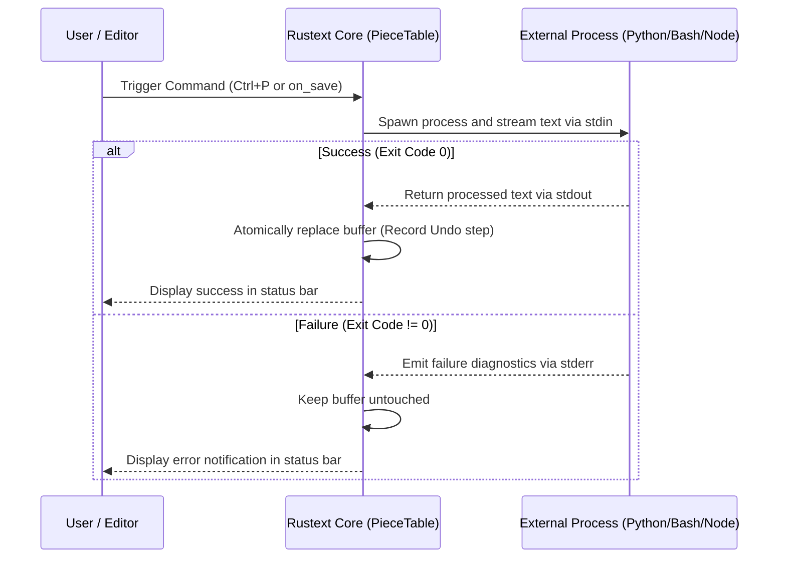

# 🎨 Rustext Theme and Extension Creation Manual

[](Cargo.toml)
[](https://github.com/boleklolek/rustext/actions)
[](LICENSE)
[](src/)
[](Cargo.toml)
[](#)

This manual provides a comprehensive guide for developers and users on how to customize, design, and create new **Visual Themes** as well as develop **Extensions and Plugins** in **Rustext**.

---

## 📑 Table of Contents

1. [Architecture and Design Principles](#1-architecture-and-design-principles)
2. [Visual Themes Guide](#2-visual-themes-guide)
   - [2.1 Built-in Official Themes](#21-built-in-official-themes)
   - [2.2 How to Select and Switch Themes](#22-how-to-select-and-switch-themes)
   - [2.3 Hot Reloading with config.ini](#23-hot-reloading-with-configini)
   - [2.4 Anatomy of the Color Engine (ARGB 32-bit and ANSI 256)](#24-anatomy-of-the-color-engine-argb-32-bit-and-ansi-256)
   - [2.5 ThemeColors Property Reference](#25-themecolors-property-reference)
   - [2.6 Creating User Themes (.theme) Without Modifying Source Code!](#26-creating-user-themes-theme-without-modifying-source-code)
   - [2.7 Compiling Native Themes into the Core (Optional for Developers)](#27-compiling-native-themes-into-the-core-optional-for-developers)
3. [Extensions and Plugins Guide](#3-extensions-and-plugins-guide)
   - [3.1 Subprocess Architecture and Polyglot IPC](#31-subprocess-architecture-and-polyglot-ipc)
   - [3.2 Extension Locations (Global and Workspace)](#32-extension-locations-global-and-workspace)
   - [3.3 Visual Extension Manager (Ctrl + Shift + X)](#33-visual-extension-manager-ctrl--shift--x)
   - [3.4 extension.conf Manifest Specification](#34-extensionconf-manifest-specification)
   - [3.5 Communication Protocol (stdin, stdout, and stderr)](#35-communication-protocol-stdin-stdout-and-stderr)
   - [3.6 Automatic Execution on Save (on_save)](#36-automatic-execution-on-save-on_save)
4. [Step-by-Step Tutorials: Creating Extensions](#4-step-by-step-tutorials-creating-extensions)
   - [Tutorial 1: Python Extension (JSON Formatter & Validator)](#tutorial-1-python-extension-json-formatter--validator)
   - [Tutorial 2: Bash / Shell Extension (AGPLv3 License Header)](#tutorial-2-bash--shell-extension-agplv3-license-header)
   - [Tutorial 3: Direct Unix Command Extension (Uppercase Transformer)](#tutorial-3-direct-unix-command-extension-uppercase-transformer)
   - [Tutorial 4: Node.js Extension (Minifier and Key Sorter)](#tutorial-4-nodejs-extension-minifier-and-key-sorter)
   - [Tutorial 5: Pure Rust Native Plugin (Plugin Trait)](#tutorial-5-pure-rust-native-plugin-plugin-trait)
5. [Troubleshooting and Best Practices](#5-troubleshooting-and-best-practices)
6. [Keyboard Shortcuts Summary](#6-keyboard-shortcuts-summary)

---

## 1. Architecture and Design Principles

Rustext is built on the premise of **zero third-party dependencies** and **maximum security isolation**:

* **Themes**: The desktop GUI renderer operates on a 32-bit linear ARGB framebuffer with sRGB IEC 61966-2-1 gamma correction and subpixel antialiasing. Themes define structured palettes driving the lexical highlighter, modal dialogs, tabs, rainbow bracket pairs, and line gutters.
* **Extensions**: Unlike editors built on JavaScript runtimes or WebViews that run third-party code in the main editor thread—introducing crash risks and excessive memory overhead—Rustext utilizes an **isolated subprocess model (IPC)**.
  * An extension can be authored in **any programming language** (Python, Bash, Node.js, C, compiled Rust binaries, Go, Ruby, etc.).
  * If an extension fails, throws an unhandled exception, or hangs, the editor remains **100% stable, secure, and responsive**.
  * Internal editor memory is completely unexposed (`CWE-829 / CWE-94` fully mitigated).

---

## 2. Visual Themes Guide

### 2.1 Built-in Official Themes

Rustext includes 8 optimized, factory-tuned visual themes:

| Identifier | Interface Name | Style |
| :--- | :--- | :--- |
| `tokyo-night` | **Tokyo Night** | Deep blue, violets, and neon cyan (inspired by Folke Tokyo Night) |
| `catppuccin` | **Catppuccin Mocha** | Soothing pastel tones on dark chocolate background (#1e1e2e) |
| `onedark` | **One Dark Pro** | Classic Atom / One Dark balanced aesthetic |
| `dark` | **Modern Dark** | Minimalist contemporary dark (#1e1e1e) |
| `monokai` | **Monokai Classic** | High contrast canary yellow, magenta, and lime green |
| `solarized` | **Solarized Dark** | Classic teal-cyan (#002b36) with Ethan Schoonover's mathematical contrast ratios |
| `light` | **Light (GitHub Light)** | Crisp, pure white background for high-ambient-light environments |
| `dracula` | **Dracula Official** | Gothic dark (#282A36) with signature vampire purple, green, and cyan |

#### Modular Official Files (`assets/themes/`)

All official Rustext themes are modularized and available as standalone files in the repository's [`assets/themes/`](assets/themes/) directory:

* [`assets/themes/tokyo-night.theme`](assets/themes/tokyo-night.theme)
* [`assets/themes/catppuccin-mocha.theme`](assets/themes/catppuccin-mocha.theme)
* [`assets/themes/one-dark.theme`](assets/themes/one-dark.theme)
* [`assets/themes/modern-dark.theme`](assets/themes/modern-dark.theme)
* [`assets/themes/monokai.theme`](assets/themes/monokai.theme)
* [`assets/themes/solarized-dark.theme`](assets/themes/solarized-dark.theme)
* [`assets/themes/light.theme`](assets/themes/light.theme)
* [`assets/themes/dracula.theme`](assets/themes/dracula.theme)

---

### 2.2 How to Select and Switch Themes

There are three ways to switch the active theme:

1. **Command Palette (`Ctrl + P`)**:
   * Press `Ctrl + P`.
   * Type `Theme:` and use Up/Down arrows to preview in real-time, then press `Enter` to apply.
2. **Native Menu Bar**:
   * Click **Preferences > Theme** and choose your desired palette.
3. **Configuration File (`config.ini`)**:
   * Modify the `name` key under the `[theme]` section in `config.ini`.

---

### 2.3 Hot Reloading with config.ini

The main configuration file is located at:
* **Linux / macOS**: `~/.config/rustext/config.ini`
* **Windows**: `%APPDATA%\rustext\config.ini`

To permanently change the default theme, edit the `[theme]` section:

```ini
; ==============================================================================
; Rustext Visual Theme Configuration
; ==============================================================================
[theme]
; Available options: tokyo-night, catppuccin, onedark, dark, monokai, solarized, light, dracula, or custom <name>.theme
name = catppuccin
```

As soon as the file is saved to disk, Rustext's configuration watcher detects the change and redraws the window instantly without requiring a restart.

---

### 2.4 Anatomy of the Color Engine (ARGB 32-bit and ANSI 256)

Rustext renders color across two layers:
1. **Desktop GUI**: Every color is stored as a 32-bit unsigned integer (`u32`) formatted as `0x00RRGGBB`. For example, `0x001A1B26` corresponds to Red=`0x1A`, Green=`0x1B`, Blue=`0x26`.
2. **Terminal TUI**: Colors map to direct ANSI escape sequences (16 or 256 colors) in [`src/ui/theme.rs`](src/ui/theme.rs).

---

### 2.5 ThemeColors Property Reference

In [`src/gfx/renderer.rs`](src/gfx/renderer.rs), the `ThemeColors` struct provides the following color slots:

#### Interface Structure and Canvas
* `background`: Main background color for the text editing area.
* `gutter_bg`: Line number gutter background color.
* `gutter_fg`: Inactive line number text color.
* `gutter_border`: Vertical separator line between gutter and code canvas.
* `tab_bar_bg`: Horizontal tab bar background.
* `tab_active_bg`: Active document tab background.
* `tab_inactive_bg`: Background color of inactive tabs.
* `tab_active_fg`: Active tab label text color.
* `tab_inactive_fg`: Inactive tab label text color.
* `status_bar_bg`: Bottom status bar background.
* `status_bar_fg`: Informational text color in the status bar.
* `selection_bg`: Highlight background for selected text.
* `cursor`: Caret / cursor color (smooth pulse or solid block).
* `accent`: Accent color for focused borders, buttons, and primary highlights.

#### Modal Dialogs and Controls
* `modal_bg`: Floating window background (Command Palette, Extension Manager).
* `modal_header_bg`: Modal title bar background.
* `modal_border`: Perimeter border color for modal windows.
* `input_bg`: Interactive text input field background.
* `input_border`: Active input field border color.
* `button_bg` / `button_hover_bg` / `button_fg`: Interactive button styling.
* `chip_bg` / `chip_fg`: Badge and pill label colors.

#### Scrollbars and Visual Guides
* `scrollbar_bg`: Scrollbar track background.
* `scrollbar_border`: Visual divider for scroll tracks.
* `scrollbar_thumb`: Idle scrollbar thumb color.
* `scrollbar_thumb_hover`: Hovered scrollbar thumb color.
* `scrollbar_thumb_active`: Dragging / active scrollbar thumb color.
* `current_line_bg`: Subtle background highlight for the line holding the cursor.
* `ruler_color`: Column guideline color (e.g. columns 80 and 120).
* `sticky_header_bg`: Background color for Sticky Scroll headers.

#### Syntax Highlighting
* `syntax_keyword`: Reserved keywords (`fn`, `let`, `mut`, `if`, `pub`, `struct`, etc.).
* `syntax_type`: Data types (`u32`, `String`, `Option`, `bool`, etc.).
* `syntax_string`: String literals (`"hello world"`).
* `syntax_number`: Numeric literals (`42`, `3.14`, `0xFF`).
* `syntax_comment`: Code comments (`// ...`, `/* ... */`).
* `syntax_operator`: Arithmetic and logical operators (`+`, `-`, `=`, `&&`, `|`).
* `syntax_punctuation`: Punctuation symbols (dots, commas, colons, semicolons).
* `syntax_plain`: Plain text and identifiers.
* `syntax_function`: Function declarations and invocations.
* `syntax_method`: Object and struct methods.
* `syntax_struct`: Struct and class names.
* `syntax_trait`: Interfaces and traits.
* `syntax_macro`: Macros (`println!`, `vec!`, etc.).
* `syntax_parameter`: Function parameters.
* `syntax_constant`: Uppercase constants (`MAX_SIZE`).
* `syntax_field`: Struct fields (`object.field`).

#### Rainbow Bracket Pairs (Bracket Pair Colorization)
* `bracket_0`: Nesting level 0 (`()`, `{}`, `[]`).
* `bracket_1`: Nesting level 1.
* `bracket_2`: Nesting level 2.

---

### 2.6 Creating User Themes (`.theme`) Without Modifying Source Code!

> [!IMPORTANT]
> **No need to touch Rust source code or recompile the editor!**
> Rustext includes a built-in dynamic theme loader that parses declarative text files in `.theme` and `.ini` format. You can define any number of custom palettes simply by saving a file in your user folder or workspace.

#### Where to save custom themes:
1. **Global User Themes**:
   * Linux / macOS: `~/.rustext/themes/<name>.theme` (or `~/.config/rustext/themes/<name>.theme`)
   * Windows: `%USERPROFILE%\.rustext\themes\<name>.theme`
2. **Local Project Themes (Workspace)**:
   * `./.rustext/themes/<name>.theme` (ideal for committing shared project themes directly to Git).

On its first launch, if the directory `~/.rustext/themes/` does not exist or is empty, Rustext automatically creates it and **deploys all 8 official theme templates**:
* `tokyo-night.theme`
* `catppuccin-mocha.theme`
* `one-dark.theme`
* `modern-dark.theme`
* `monokai.theme`
* `solarized-dark.theme`
* `light.theme`
* `dracula.theme`

This allows you to open any template, tweak colors, and see changes live immediately.

#### Search Order and Override Priority
When Rustext resolves a theme (e.g., `tokyo-night`, `dracula`, or a new identifier like `nord`):
1. **Local Workspace (`./.rustext/themes/<name>.theme`)**: Highest priority. Overrides all other definitions.
2. **Global User Folder (`~/.rustext/themes/<name>.theme`)**: Second priority. Customizes themes across all sessions.
3. **Hardcoded Core Themes**: Embedded compiled fallback in the binary if no matching disk file exists.

> [!TIP]
> **No-code custom tweaks**: To adjust the background or accent color of `tokyo-night`, simply edit `~/.rustext/themes/tokyo-night.theme`. Rustext prioritizes your disk file without modifying any Rust code.

#### Anatomy of a `.theme` File
Theme files use standard INI syntax with flexible hexadecimal notation:
* `#RRGGBB` or `0xRRGGBB` (e.g., `#282A36` or `0x282A36`)
* `#RGB` shorthand (e.g., `#F80` expands to `#FF8800`)
* Line or inline comments starting with `;` or space followed by `#` (e.g., `background = #282A36 # Comment`)
* Any omitted keys fall back cleanly to baseline defaults according to `type = dark` or `type = light`.

Example: `~/.rustext/themes/dracula.theme`:

```ini
# ==============================================================================
# Rustext Theme: Dracula
# Location: ~/.rustext/themes/dracula.theme
# ==============================================================================
[meta]
id = dracula
name = Dracula
author = Dracula Theme Team
type = dark   ; 'dark' or 'light' (determines baseline fallbacks)

[ui]
background = #282A36
gutter_bg = #21222C
gutter_fg = #6272A4
gutter_border = #191A21
tab_bar_bg = #191A21
tab_active_bg = #282A36
tab_inactive_bg = #21222C
tab_active_fg = #F8F8F2
tab_inactive_fg = #6272A4
status_bar_bg = #21222C
status_bar_fg = #F8F8F2
selection_bg = #44475A
cursor = #F8F8F0
accent = #BD93F9
current_line_bg = #44475A
ruler_color = #44475A
sticky_header_bg = #21222C

# Modals, dialogs, and controls
modal_bg = #282A36
modal_header_bg = #21222C
modal_border = #BD93F9
input_bg = #191A21
input_border = #BD93F9
button_bg = #44475A
button_hover_bg = #6272A4
button_fg = #F8F8F2
chip_bg = #44475A
chip_fg = #BD93F9

# Scrollbar
scrollbar_bg = #282A36
scrollbar_border = #21222C
scrollbar_thumb = #44475A
scrollbar_thumb_hover = #6272A4
scrollbar_thumb_active = #BD93F9

[syntax]
keyword = #FF79C6
type = #8BE9FD
string = #F1FA8C
number = #BD93F9
comment = #6272A4
operator = #FF79C6
punctuation = #F8F8F2
plain = #F8F8F2
function = #50FA7B
method = #50FA7B
struct = #8BE9FD
trait = #50FA7B
macro = #FF79C6
parameter = #FFB86C
constant = #BD93F9
field = #F8F8F2

[brackets]
bracket_0 = #BD93F9
bracket_1 = #FF79C6
bracket_2 = #8BE9FD
```

#### How to Activate Your Custom Theme:
1. **Via `config.ini`**:
   Specify the theme ID in `~/.config/rustext/config.ini`:
   ```ini
   [theme]
   name = dracula
   ```
   Rustext hot-reloads the theme instantly upon file save.
2. **Via Command Palette (`Ctrl + P`)**:
   Rustext auto-discovers all themes inside `~/.rustext/themes/`.
   Press `Ctrl + P`, type `Theme:`, and choose your theme directly (e.g. `Theme: Dracula (Custom)`).

---

### 2.7 Compiling Native Themes into the Core (Optional for Developers)

If you are a core contributor and want a new theme to be permanently bundled directly into the standalone binary:

1. Add a constructor method to `ThemeColors` in `src/gfx/renderer.rs` (e.g., `pub fn my_theme() -> Self`).
2. Add the alias to `ThemeColors::by_name()`.
3. Register the variant in the `EditorTheme` enum in `src/editor/config.rs`.
4. Add the menu entry in `src/editor/menu.rs` and the command list in `src/ui/prompt.rs`.

---

## 3. Extensions and Plugins Guide

### 3.1 Subprocess Architecture and Polyglot IPC

Rustext requires no Node.js runtime, V8 engine, or embedded interpreter to run extensions. It uses universal OS primitives:
* When an extension is invoked, Rustext spawns the external process (`std::process::Command`).
* The current buffer contents are streamed via standard input (`stdin`).
* Clean transformed output is collected via standard output (`stdout`).
* If the process exits with status code `0`, the buffer updates in memory atomically, creating a transaction in the **Undo / Redo** stack.
* If the process exits with an error status (`stderr`), the error message appears in the status bar while **your file remains completely untouched**, guaranteeing absolute document safety.



---

### 3.2 Extension Locations (Global and Workspace)

Rustext scans two directories:
1. **Global User Extensions**:
   * Linux / macOS: `~/.rustext/extensions/`
   * Windows: `%USERPROFILE%\.rustext\extensions\`
2. **Project Workspace Extensions**:
   * `./.rustext/extensions/` located in the root of the active workspace.

> [!TIP]
> You can commit the `.rustext/extensions/` directory to your project's Git repository so your entire development team automatically shares formatters and code generation tools without manual setup.

---

### 3.3 Visual Extension Manager (Ctrl + Shift + X)

Rustext includes a native UI to inspect and manage extensions:

* **Shortcut**: Press `Ctrl + Shift + X` (or navigate to **Extensions > Extension Manager...**).
* **Keyboard navigation**:
  * `↑` / `↓`: Navigate between installed extensions.
  * `Space`: **Enable / Disable** selected extension (persisted instantly to `extension.conf`).
  * `R`: **Hot reload** all extensions from disk.
  * `N`: **Create an Example Extension** automatically in your user directory.
  * `Esc`: Dismiss the modal dialog.

---

### 3.4 extension.conf Manifest Specification

Each extension lives in its own dedicated directory and must include an `extension.conf` manifest.

#### Manifest Key Reference:

```ini
# Unique alphanumeric identifier (no spaces)
id = my_extension

# Friendly display name shown in the Extension Manager
name = My Custom Tool

# Semantic versioning string
version = 1.0.0

# Author or team name
author = Developer

# Brief feature description
description = Transforms and cleans buffer contents

# Default activation state (true = enabled, false = disabled)
enabled = true

# Commands exposed to the Command Palette (Ctrl+P)
# Syntax: command_id:Menu Display Label
commands = execute_cleanup:Clean Source Code

# System executable to invoke (python3, sh, node, sed, etc.)
exec = python3

# Space-separated arguments passed to the executable
args = run.py

# Automatically run on every file save (Ctrl+S)
on_save = false
```

#### Script Auto-Discovery Conventions
If the `exec` key is omitted, Rustext scans the extension directory for standard entry points:
* `run.py` or `main.py`: Automatically executed with `python3 <script>`.
* `run.sh` or `extension.sh`: Automatically executed with `sh <script>`.
* `run.bat` or `run.cmd`: Automatically executed on Windows.

---

### 3.5 Communication Protocol (stdin, stdout, and stderr)

1. **Standard Input (`stdin`)**:
   The spawned subprocess receives the complete active buffer as clean UTF-8 text.
2. **Standard Output (`stdout`)**:
   Whatever the script prints to `stdout` replaces the buffer content in the editor.
3. **Standard Error (`stderr`)**:
   If the script exits with a non-zero exit status (e.g., `sys.exit(1)` in Python or `exit 1` in Bash), any text emitted to `stderr` is rendered as an error alert in the status bar, and no changes are committed to the buffer.

---

### 3.6 Automatic Execution on Save (on_save)

Setting `on_save = true` in `extension.conf`:
* Pipes the buffer through the tool whenever `Ctrl + S` is triggered before writing to disk.
* Seamlessly formats files in place.
* Ideal for tools such as `black`, `rustfmt`, `prettier`, `clang-format`, or whitespace cleaners.

---

## 4. Step-by-Step Tutorials: Creating Extensions

### Tutorial 1: Python Extension (JSON Formatter & Validator)

Build an extension to format and validate JSON files:

1. **Create the directory**:
   ```bash
   mkdir -p ~/.rustext/extensions/json_formatter
   ```

2. **Create the manifest** `~/.rustext/extensions/json_formatter/extension.conf`:
   ```ini
   id = json_formatter
   name = Elegant JSON Formatter
   version = 1.0.0
   author = Rustext Developer
   description = Formats and indents JSON files using standard Python
   enabled = true
   commands = format_json:Format Full JSON
   exec = python3
   args = run.py
   on_save = false
   ```

3. **Create the script** `~/.rustext/extensions/json_formatter/run.py`:
   ```python
   #!/usr/bin/env python3
   import sys
   import json

   def main():
       # Read full buffer from stdin
       incoming = sys.stdin.read()
       
       if not incoming.strip():
           sys.stdout.write(incoming)
           return

       try:
           data = json.loads(incoming)
           # Format with 2 spaces and preserve UTF-8 characters
           output = json.dumps(data, indent=2, ensure_ascii=False) + "\n"
           sys.stdout.write(output)
       except json.JSONDecodeError as err:
           # Rustext renders stderr in the status bar
           sys.stderr.write(f"JSON Error: line {err.lineno}, col {err.colno}: {err.msg}")
           sys.exit(1)

   if __name__ == "__main__":
       main()
   ```

4. **Test the extension**:
   * In Rustext, press `Ctrl + Shift + X` and press `R` to reload extensions.
   * Open a JSON file, press `Ctrl + P`, type `[Ext] Format Full JSON`, and press `Enter`.

---

### Tutorial 2: Bash / Shell Extension (AGPLv3 License Header)

An extension that inserts a licensing header at the top of the file:

1. **Create the directory**:
   ```bash
   mkdir -p ~/.rustext/extensions/insert_license
   ```

2. **Create the manifest** `~/.rustext/extensions/insert_license/extension.conf`:
   ```ini
   id = insert_license
   name = Insert License Header
   version = 1.0.0
   author = My Team
   description = Inserts AGPLv3 header at the top of the current buffer
   enabled = true
   commands = add_lic:Insert AGPLv3 Header
   exec = sh
   args = run.sh
   on_save = false
   ```

3. **Create the script** `~/.rustext/extensions/insert_license/run.sh`:
   ```bash
   #!/bin/sh
   YEAR=$(date +%Y)
   
   # Print license header
   cat << EOF
   // =============================================================================
   // Copyright (c) $YEAR. All rights reserved.
   // Distributed under the terms of the GNU AGPLv3 License.
   // =============================================================================

   EOF
   
   # Concatenate original buffer content
   cat -
   ```

4. **Set execution permissions**:
   ```bash
   chmod +x ~/.rustext/extensions/insert_license/run.sh
   ```

---

### Tutorial 3: Direct Unix Command Extension (Uppercase Transformer)

You can invoke standard Unix utilities directly without wrapper scripts:

`~/.rustext/extensions/uppercase/extension.conf`:
```ini
id = uppercase
name = Transform to Uppercase
version = 1.0.0
author = Rustext
description = Converts all text in the active buffer to uppercase using tr
enabled = true
commands = to_upper:Convert All to Uppercase
exec = tr
args = [:lower:] [:upper:]
on_save = false
```

---

### Tutorial 4: Node.js Extension (Minifier and Key Sorter)

`~/.rustext/extensions/node_tools/extension.conf`:
```ini
id = node_tools
name = Node.js Cleaner
version = 1.0.0
author = JavaScript Team
description = Alphabetically sorts keys in JSON objects
enabled = true
commands = sort_keys:Sort Keys Alphabetically
exec = node
args = index.js
on_save = false
```

`~/.rustext/extensions/node_tools/index.js`:
```javascript
const fs = require('fs');

const input = fs.readFileSync(0, 'utf-8');

try {
  const obj = JSON.parse(input);
  const sorted = Object.keys(obj).sort().reduce((acc, key) => {
    acc[key] = obj[key];
    return acc;
  }, {});
  process.stdout.write(JSON.stringify(sorted, null, 2) + '\n');
} catch (e) {
  process.stderr.write('Processing error: ' + e.message);
  process.exit(1);
}
```

---

### Tutorial 5: Pure Rust Native Plugin (Plugin Trait)

For maximum nanosecond execution performance compiled directly into the binary (such as [`TrailingWhitespacePlugin`](src/plugin/mod.rs)):

The plugin lifecycle is defined in [`src/plugin/traits.rs`](src/plugin/traits.rs):

```rust
use crate::plugin::{Plugin, PluginContext};

pub struct MyNativePlugin {
    counter: usize,
}

impl Plugin for MyNativePlugin {
    fn name(&self) -> &str {
        "My Native Plugin"
    }

    fn on_init(&mut self, ctx: &mut PluginContext) {
        ctx.set_status("Native plugin successfully initialized");
    }

    fn on_before_save(&mut self, _ctx: &mut PluginContext, content: &mut String) {
        // In-place modification before flushing to disk
        *content = content.trim_end().to_string();
        content.push('\n');
    }

    fn on_command(&mut self, ctx: &mut PluginContext, command: &str) -> bool {
        if command == "my_native_command" {
            self.counter += 1;
            ctx.set_status(format!("Command executed {} times", self.counter));
            return true;
        }
        false
    }
}
```

---

## 5. Troubleshooting and Best Practices

### 1. Extension does not appear in Command Palette (`Ctrl + P`)
* **Check the Extension Manager**: Open `Ctrl + Shift + X` and confirm the extension is listed. If missing, ensure the manifest is strictly named `extension.conf`.
* **Check enabled status**: Ensure the extension shows `[Enabled]`. If `[Disabled]`, press `Space` to toggle it.
* **Hot reload**: Press `R` in the Extension Manager or run `Extensions: Reload` in the Command Palette.

### 2. Command fails with "Failed to spawn process"
* The executable specified in `exec` (e.g. `python3`, `node`) is missing from system `PATH`.
* Provide an absolute path (e.g. `exec = /usr/bin/python3`).

### 3. "Permission Denied" on Linux / macOS
* Ensure shell scripts or binaries have executable permissions set:
  ```bash
  chmod +x ~/.rustext/extensions/my_ext/run.sh
  ```

### 4. Debugging Extension Issues
* Rustext automatically captures any output on `stderr` and displays it in the bottom status bar.
* Send debug diagnostics directly to `stderr`:
  ```python
  import sys
  sys.stderr.write("Debug: Process executed successfully")
  ```

---

## 6. Keyboard Shortcuts Summary

| Shortcut | Action | Context |
| :--- | :--- | :--- |
| **`Ctrl + Shift + X`** | **Open Extension Manager** | Global |
| **`Ctrl + P`** | **Command Palette (Search `Theme:` or `[Ext]`)** | Global |
| **`Space`** | **Enable / Disable Extension** | Inside Extension Manager |
| **`R`** | **Hot reload all extensions from disk** | Inside Extension Manager |
| **`N`** | **Create Example Extension template** | Inside Extension Manager |
| **`Esc`** | **Dismiss Modal Dialog** | Inside Extension Manager |

---

*Crafted with passion for the open source community under the GNU AGPLv3 License.*
