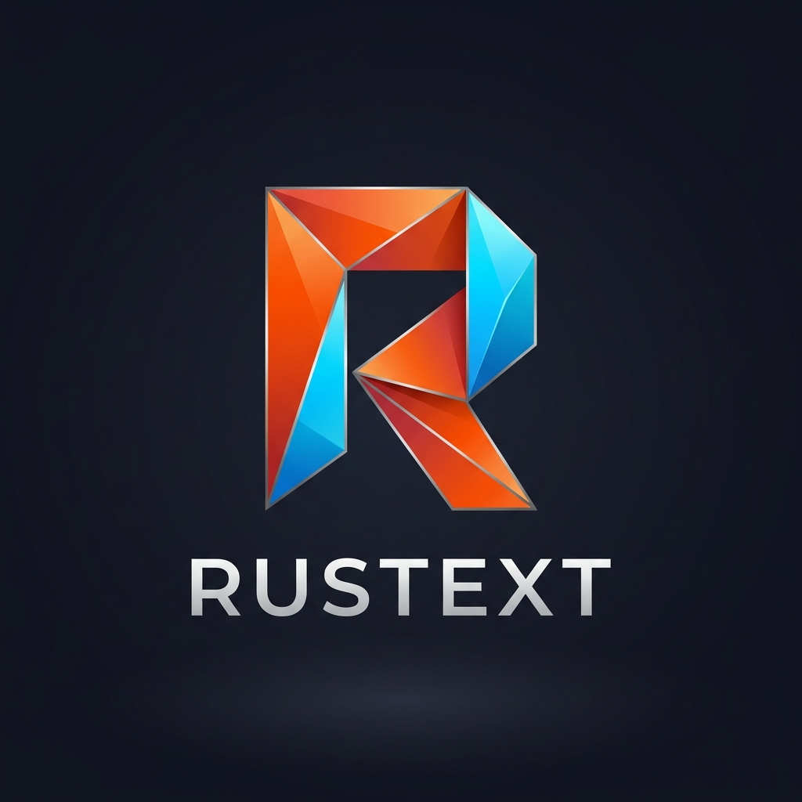

<p align="center">
  
</p>

<h1 align="center">🦀 Rustext</h1>

<p align="center">
  <b>Ultra-low latency, high-performance native code and text editor</b><br>
  <i>100% Pure Standard Rust • Zero Third-Party Dependencies (`std::*`) • ~2ms Startup Time</i>
</p>

<p align="center">
  <a href="README.md">🇪🇸 Leer en Español</a> • 
  <a href="README_EN.md">🇬🇧 Read in English</a>
</p>

<p align="center">
  <a href="Cargo.toml"></a>
  <a href="https://github.com/boleklolek/rustext/actions"></a>
  <a href="LICENSE"></a>
  <a href="src/"></a>
  <a href="Cargo.toml"></a>
  <a href="Cargo.toml"></a>
  <a href="tests/"></a>
  <a href="#"></a>
  <a href="#"></a>
</p>

---

**Rustext** is an ultra-low latency, high-performance native text and code editor written **100% in pure Rust using exclusively the standard library (`std`)**, with **zero third-party dependencies** (a completely empty `Cargo.toml`).

Inspired by the speed and immediacy of **Sublime Text** and the modern developer ergonomics of **VS Code / Zed**, Rustext delivers a fluid native editing experience on any machine, starting up in **~2 milliseconds** and using only a fraction of the memory consumed by conventional editors.

Refer to the [**📖 User Manual and Complete Technical Reference (MANUAL.md)**](MANUAL.md) for in-depth architectural explanations, configuration details, and development tooling.

---

```text
┌──────────────────────────────────────────────────────────────────────────────────────────────────┐
│ File   Edit   Selection   View   Preferences   Extensions   Tools   Help                         │  ← Native Menu Bar
├──────────────────┬───────────────────────────────────────────┬───────────────────────────────────┤
│ PROJECT [+] ↺ ×  │ 1: main.rs [ACTIVE]                       │ 2: config.ini                     │  ← Split Editor (Ctrl+\)
├──────────────────┼───────────────────────────────────────────┼───────────────────────────────────┤
│ ▼ src            │ 1 │ pub fn main() {                    ▲  │ 1 │ [gui]                      ▲  │
│   • lib.rs       │ 2 │     let config = EditorConfig();   █  │ 2 │ minimap = true           █  │  ← Viewport Slider
│   • main.rs      │ 3 │     println!("Rustext ready");     │  │ 3 │ minimap_width = 100    │  │
│ ▶ editor         │ 4 │ }                                  ▼  │ 4 │ theme = "tokyo-night"      ▼  │
│ ▶ gfx            │ ~ │                                    ░  │ ~ │                                ░  │  ← Syntax Minimap
├──────────────────┴───────────────────────────────────────────┴───────────────────────────────────┤
│ [ EDIT ]  src/main.rs  |  Line 3, Col 5  |  UTF-8  |  Rust  |  Cursors: 1  |  Pane: 1/2          │  ← Status Bar
└──────────────────────────────────────────────────────────────────────────────────────────────────┘
```

---

## ⚡ Key Features

- **Zero External Dependencies (`100% clean Cargo.toml`)**:
  - Standalone compiled binary of only **~650 KB**.
  - Full clean compilation in **under 2 seconds**.
  - Completely immune to supply-chain security risks, dependency hijacking, and out-of-date packages.

- **High-Performance Piece Table Buffer Architecture**:
  - `PieceTable` structure with immutable original file memory and dynamic append-only edit buffers.
  - *Zero-copy* iteration over fragments with no redundant string allocations.
  - Complete, battle-tested support for multi-byte UTF-8 glyphs and symbols.

- **Parallel Vector Multi-Cursor Engine**:
  - Simultaneous multi-point editing with automatic offset shifting.
  - Next occurrence selection via `Ctrl + D` (Sublime Text / VS Code style).
  - Add cursors on contiguous lines with `Ctrl + K` (above) and `Ctrl + J` (below).
  - Reversible atomic transactions via `Ctrl + Z` (Undo) and `Ctrl + Y` (Redo).

- **Live Git Integration (Git Gutter, Inline Blame & Hunk Diff Popup)**:
  - Real-time color-coded gutter bars for instant diff visualization (+ green for added lines, ~ blue for modified, ▲ red for deleted).
  - **Real-Time Inline Git Blame**: Dimmed ghost text annotation at the end of the primary cursor line displaying author, relative time, and commit message (`author, X ago • message`). Non-blocking inspection with an in-memory $\mathcal{O}(1)$ associative cache for 0ms rendering latency.
  - **Floating Git Hunk Diff Modal (`Alt + H`)**: Translucent floating popup with soft shadows displaying the exact diff block against Git HEAD, highlighting deleted lines (`-` in soft red) and added lines (`+` in soft green).
  - **Atomic Hunk Reversion (`Alt + R`)**: Instantly restore the selected modified, added, or deleted hunk back to its Git HEAD state without affecting the rest of the file, seamlessly integrated with the undo/redo stack (`Ctrl + Z`).
  - Active branch chip in the status bar with change counters (`git: main (+3 ~1)`).
  - Sidebar Explorer visual status badges (`M` modified in yellow, `U` untracked in green, `D` deleted in red, `A` added in cyan).
  - Blazing fast detection directly reading `.git/HEAD` without blocking the editor, powered by a high-speed in-memory LCS algorithm.
  - Quick refresh shortcut `Ctrl + Shift + G` and `git_gutter = true` option in `config.ini`.

- **Graphical Code Minimap (`Ctrl + M`)**:
  - Condensed miniature visualization of the entire source code along the editor edge.
  - Micro-rendering of syntax tokens preserving indentation levels.
  - Interactive translucent viewport slider highlighting the currently visible screen window in real time.
  - Instant reactive navigation: click anywhere to jump or drag the slider with the mouse.
  - Fully configurable via `config.ini` (`minimap = true`, `minimap_width = 100`).

- **Independent View Splitting (Split Editor)**:
  - Vertical split (side-by-side, `Ctrl + \`) and horizontal split (stacked, `Ctrl + Shift + \`).
  - Instant pane focus switching with `Alt + \` or by direct mouse click.
  - Draggable splitter divider to dynamically redistribute screen real estate.
  - Each pane maintains independent vertical/horizontal scrolling, cursors, status headers, gutters, minimaps, and scrollbars.
  - Seamless tab and file synchronization when toggling or closing panes.

- **Data Loss Prevention (Unsaved Changes Confirmation Dialog)**:
  - Intelligent dirty-state detection (`is_dirty()`) before closing tabs (`Ctrl + W`, clicking tab `×`, or menu) or quitting the editor (`Ctrl + Q`, `File > Exit`, or OS window close `[X]`).
  - Modal dialog with 3 clear actions: **Save** / **Save All** (`S`), **Don't Save** / **Discard All** (`D`/`N`), and **Cancel** (`Esc`/`C`).
  - Fully interactive: keyboard navigation (`←`/`→`/`Tab`/`Enter`), mnemonic keys, and hover-reactive mouse clicks.
  - When quitting with multiple modified tabs, alerts with the exact count of pending unsaved files before proceeding.

- **Modern Desktop GUI**:
  - Software rendering engine with a 32-bit ARGB Framebuffer.
  - Anti-aliased rounded corners, smooth drop shadows, and status chips.
  - Native menu bar with mouse navigation and `Alt + Letter` mnemonic shortcuts.
  - Smooth scrollbar with draggable thumb and page click handling.
  - 8 Built-in color palettes: Tokyo Night, Catppuccin Mocha, One Dark, Modern Dark, Monokai, Solarized Dark, GitHub Light, and Dracula.

- **Dynamic & Declarative Theme Engine (`.theme` / `.ini`) without Recompilation**:
  - Hot reload and automatic discovery of visual themes from user folders (`~/.rustext/themes/`) or project directories (`./.rustext/themes/`) without touching source code (`src/gfx/renderer.rs`) or recompiling.
  - 8 Modular official themes located in [`assets/themes/`](assets/themes/) (`tokyo-night.theme`, `catppuccin-mocha.theme`, `one-dark.theme`, `modern-dark.theme`, `monokai.theme`, `solarized-dark.theme`, `light.theme`, `dracula.theme`).
  - Automatic deployment of official theme templates to `~/.rustext/themes/` on first launch if empty.
  - Dynamic override hierarchy: any disk `.theme` file overrides the compiled-in theme of the same name, enabling on-the-fly tweaking.
  - High-speed zero-dependency parser supporting `#RRGGBB`, `0xRRGGBB`, `#RGB` formats and inline comments with base theme auto-detection (`type = dark` / `light`).
  - Instant discovery and activation via Command Palette (`Ctrl + P` -> `Tema: <name>`) or by declaring `name = <name>` in `config.ini`.

- **Font Rasterizer & Gamma Correction (sRGB IEC 61966-2-1)**:
  - Advanced software font rasterizer with spatial anti-aliasing and continuous contour coverage computation.
  - Physically accurate composition in linear light space ($\text{sRGB} \leftrightarrow \text{Linear Light}$) compliant with IEC 61966-2-1.
  - Eliminates the classic font thinning and dark halo artifacts on dark backgrounds (Tokyo Night, Catppuccin) caused by naive non-linear blending.
  - Continuous bilinear scaling (`font_scale >= 2`) for HiDPI displays without pixelation or staircase artifacts.
  - Static $\mathcal{O}(1)$ lookup tables of just 4.5 KB in L1 cache (`SRGB_TO_LINEAR_LUT` and `LINEAR_TO_SRGB_LUT`), achieving throughput exceeding 550 FPS with zero heap allocations.
  - 100% geometric sharpness preservation for box-drawing and boundary characters (`│`, `─`, `┌`, `█`, etc.).
  - Fully configurable via `config.ini` (`font_antialiasing = true`, `gamma_correction = true`).

- **Native HiDPI Support & Monitor Coordinate Scaling**:
  - Precise auto-detection of display scaling factors (`scale_factor`) reported by the monitor and OS (X11 DPI / `Xft.dpi` / env vars `RUSTEXT_SCALE_FACTOR`, `GDK_SCALE`, `QT_SCALE_FACTOR`, `XCURSOR_SIZE`; Win32 `GetDpiForWindow` / `USER_DEFAULT_SCREEN_DPI`; macOS Retina backing scale).
  - Rigorous mathematical multiplication of logical design coordinates to produce exact physical pixels in the `Framebuffer`: window dimensions, menu bars, tabs, status bars, integrated terminal, scrollbars, minimaps, gutters, split panes, and modal dialogs.
  - Bidirectional subpixel and physical pixel mapping of mouse input and cursor events.
  - Fully configurable via `config.ini` (`scale_factor = 0.0` for auto-detection, or explicit factors like `1.5`, `2.0`).

- **Font Shaping, Hinting, Analytical Antialiasing & Visual Effects**:
  - **Font Shaping & Coding Ligatures**: Seamless detection and rendering of multi-character coding ligatures (`->`, `=>`, `!=`, `==`, `===`, `!==`, `<=`, `>=`, `:=`, `&&`, `||`, `::`, `..`, `...`, `/*`, `*/`, `++`, `--`), maintaining strict monospaced grid alignment and Unicode combining marks support.
  - **Pixel-Grid Hinting**: Grid-fitting and stem-snapping algorithm locking vertical strokes, crossbars, and baselines to integer physical pixels, preventing blurry or faint stems (`none`, `slight`, `medium`, `full`).
  - **Analytical Geometric Antialiasing (Exact SDF)**: Supersampling-free analytical coverage calculation for 2D primitives: subpixel-width lines (Xiaolin Wu), circles and rings, rounded corners via Signed Distance Fields (2D Box SDF), rounded rectangles, and analytical triangles.
  - **Soft Shadows & $\mathcal{O}(1)$ Gaussian Blur**: High-speed separable blur using a 3-pass sliding-window box filter running in $\mathcal{O}(1)$ time independent of blur radius. Frosted Glass acrylic translucency with reflective borders and physically attenuated soft drop shadows for floating modals and palettes.
  - **Animation Curves (Easing) & Spring Physics**: Full family of parametric curves (Quad, Cubic, Quart, Expo, Circ, Back, Bounce, Elastic), CSS-style Cubic-Bézier solver (`cubic-bezier(x1, y1, x2, y2)`) with Newton-Raphson root finding, and damped harmonic oscillators for organic spring physics.
  - **Adaptive Edge Perception & Contrast Tuning**: Perceptual adjustment based on the Weber-Fechner law and ITU-R BT.709 to modulate glyph contour contrast between dark and light themes, neutralizing visual irradiation and providing Laplacian unsharp masking.
  - Configurable via `config.ini` (`font_ligatures = true`, `font_hinting = medium`, `smooth_shadows = true`, `animation_enabled = true`, `edge_perception = true`).

- **Interactive Font Selector & Advanced Typography System (`Ctrl + Shift + T`)**:
  - Desktop floating modal dialog with dual-column layout and **live syntax preview box** re-rendering syntax-highlighted code with ligatures in real time before applying.
  - **5 Built-in Monospaced Font Families**:
    - `Standard Mono`: Balanced, crisp, and optimized for long reading sessions.
    - `Terminus Console`: High-contrast, slashed zero (`0`), hooked `l`, classic Linux console aesthetic.
    - `Modern Coding Sans`: Neo-grotesque open forms, dotted zero, minimalist code appearance.
    - `Typewriter Slab`: Mechanical rectangular slab-serif editorial style.
    - `Retro Pixel 8-Bit`: Pure arcade and 8-bit computing pixels without analytical smoothing.
  - **Continuous Bilinear Scaling & Size Selection**: Standard font sizes (`10, 11, 12, 14, 16, 18, 20, 24 pt`) sampled at subpixel accuracy without distortion.
  - **Quick Font Zoom Shortcuts**: `Ctrl + +` / `Ctrl + =` (zoom in), `Ctrl + -` (zoom out), `Ctrl + 0` (reset to 12 pt).
  - **Physical Stroke Weight**: `Normal`, `Semibold` (+35 edge coverage boost), and `Bold` (1-pixel analytical morphological horizontal dilation).
  - **Ergonomic Navigation**: Full keyboard control (`Tab`, `↑`/`↓`, `←`/`→`, `+`/`-`/`0`, `l`, `a`, `s`, `Enter`, `Esc`), mouse clicks, and interactive scroll wheel to cycle sizes.
  - Menu item `Preferences > Typography...`, Command Palette (`Ctrl + P`), and auto-persistence in `config.ini` (`font_family`, `font_size`, `font_weight`).

- **TrueType (.ttf) Vector Typography Engine, Subpixel LCD Antialiasing & Glyph Cache**:
  - **100% Pure Rust SFNT Binary Decoder**: Structured parser with zero external dependencies (no FreeType, no HarfBuzz) validating `head`, `maxp`, `loca`, `glyf`, `cmap` (format 4), `hhea`, and `hmtx` tables with defensive validation against malformed fonts.
  - **Geometric Reconstruction & Bézier Curves**: Adaptive quadratic Bézier curve subdivision down to a subpixel tolerance of **0.25 pixels**.
  - **Trapezoidal Analytical Rasterizer**: Continuous scanline area and fractional winding calculation without expensive supersampling.
  - **ClearType Subpixel LCD Antialiasing (RGB)**: $3\times$ horizontal subpixel sampling with symmetric 5-tap FIR convolution ($[1, 4, 6, 4, 1] / 16$) and linear physical gamma blending ($\gamma = 2.2$).
  - **Two-Tier Glyph Cache (`TtfGlyphCache`)**:
    - *Tier-1 (Fast ASCII Direct Table)*: Direct indexed table for printable ASCII (`32..=126`) with sub-5ns latency ($O(1)$ zero hashing cost).
    - *Tier-2 (Associative Bounded LRU Cache)*: Associative cache storing up to 4,096 entries for Unicode glyphs with 25% batch eviction, sustaining **over 1,000 FPS**.
    - Instant warmup on startup and safe invalidation upon font switching.
  - **Intelligent System Discovery**: Automatic detection of system monospace fonts (`Liberation Mono`, `Noto Sans Mono`, `DejaVu Sans Mono`, `Hack`, etc.) with in-memory fallback TrueType synthesizer.
  - Configurable via `config.ini` (`use_ttf_font = true`, `ttf_font_path = ""`, `subpixel_antialiasing = true`).

- **Flexbox Layout Engine & Fine-Grained Reactive vs. Retained UI Architecture**:
  - **100% Pure Rust Flexbox Engine**: Complete layout system inspired by the W3C CSS Flexible Box Layout specification:
    - Main and cross axes (`Row`, `Column`, `RowReverse`, `ColumnReverse`).
    - Multi-line wrapping (`FlexWrap::Wrap`, `WrapReverse`).
    - Positive free space distribution and overflow shrinking via `flex_grow`, `flex_shrink`, and `flex_basis`.
    - Main axis alignment: `JustifyContent` (`FlexStart`, `Center`, `FlexEnd`, `SpaceBetween`, `SpaceAround`, `SpaceEvenly`).
    - Cross axis alignment: `AlignItems` (`Stretch`, `Center`, `FlexStart`, `FlexEnd`, `Baseline`), per-item `AlignSelf`, and multi-line `AlignContent`.
    - Absolute (`Points`), percentage (`Percent`), and auto (`Auto`) dimensions, with margins, paddings, and item spacing (`gap`, `row_gap`, `col_gap`).
    - 2-pass recursive resolution with unlimited nesting for complex desktop interfaces.
  - **Fine-Grained Reactive Primitives**:
    - Reactive `Signal<T>` with epoch versioning and targeted observer notifications.
    - Cached derived computations `Computed<T>` (*Memos*) re-evaluating only when observed signals bump version (`eval_count`).
    - Side-effect runners `Effect` binding mutations without polling loops.
  - **Hybrid Reactive-Retained Architecture**:
    - **Immediate Mode**: Re-executes layout every frame; simple but expensive in layout calculations and state management.
    - **Retained Mode**: Persistent widget tree (`WidgetTree`, `WidgetNode`) preserving geometries, focus, and dispatching mouse events (`hit_test`, `dispatch_mouse_click`, `dispatch_mouse_move`).
    - **Rustext Reactive-Retained Design**: Persistent widgets subscribe to `Signal` primitives. When a signal mutates, only affected nodes mark `DirtyFlags` (`layout`, `paint`) upward, bypassing virtual DOM diffing and ensuring zero-latency rendering to the `Framebuffer`.

- **Project Tree & File Explorer (`Ctrl + B`)**:
  - Left-docked sidebar toggleable via `Ctrl + B`.
  - Lazy folder scanning (reads from disk only what is expanded).
  - Automated color badges per file extension (`.rs`, `.toml`, `.md`, `.py`, `.c`, etc.).
  - Mouse controls: single-click file open, folder toggle, new tab button `[+]`, refresh `[↺]`, and close `[×]`.
  - Full keyboard navigation (`↑`/`↓`, `→`/`Enter`, `←`, `Esc`).

- **Global Project Search (`Ctrl + Shift + F`)**:
  - Floating modal dialog with high-speed recursive search across the entire project tree (`root_dir`).
  - Intelligent filtering skipping binary files, files > 10 MB, and ignored directories (`.git`, `target`, `node_modules`, `.cache`, etc.).
  - Reactive search-as-you-type, case-sensitivity toggle (`Alt + C` or `[Aa]` button).
  - Code match snippets with amber highlights, file/line badges, and immediate cursor jump on click or `Enter`.

- **Workspace Management & Project Sessions**:
  - Open project folders via interactive dialog with `Ctrl + Shift + O` or *File > Open Project Folder...*.
  - Fast workspace switcher (`Ctrl + Shift + P` / `Ctrl + Alt + W`) and recent projects list in the File menu.
  - Support for `.rustext-workspace` configuration files defining project roots and settings.
  - **Total Session Isolation per Project**: Independently saves and restores per project (`~/.rustext/session_<hash>.ini`) open tabs, cursor locations, scroll offsets, and split panes without cross-project interference.
  - Active workspace name displayed in the status bar chip and sidebar header.
  - Safe *Hot Exit* draft backups (`~/.rustext/drafts/*.draft`) protecting modified content against crashes and accidental closes.

- **Recent Files Selector & Filter (`Ctrl + R`)**:
  - Interactive floating modal with real-time fuzzy filtering to quickly reopen recently accessed files.
  - Highlighted file name with dimmed directory path, keyboard navigation (`↑`/`↓`/`Enter`), and hover-reactive mouse selection.
  - Deduplicated persistent history with configurable maximum limit (`max_recent_files = 20`).

- **Integrated Native Docked Terminal (`Ctrl + \`` / `Ctrl + ~`)**:
  - Interactive console panel docked at the bottom of the editor to compile, test, or interact with the OS without leaving Rustext.
  - Automatic system shell detection (`$SHELL`, `/bin/bash`, `/bin/sh`, or `cmd.exe`/PowerShell).
  - Non-blocking bidirectional asynchronous IPC using native pipes (`Stdio::piped()`) and background threads.
  - Draggable splitter divider for real-time console resizing.
  - Header actions: `[Clear]` and `[x]` close buttons, command history (`↑`/`↓`), interrupt `Ctrl+C`, and clear `Ctrl+L`.
  - Configurable via `config.ini` (`terminal_height = 180`, `terminal_shell = ""`).

- **Bracket Pair Colorization**:
  - Real-time cyclical nesting depth lexical algorithm (`depth % 3`) for `()`, `[]`, and `{}` delimiter pairs.
  - High-contrast color palettes tailored for all 8 visual themes (gold/yellow, magenta/purple, and cyan/blue).
  - Context-aware parser ignoring delimiters inside string literals and comments for flawless precision.
  - Supported across both GUI (Framebuffer) and TUI (24-bit truecolor ANSI sequences).

- **Expanded Multi-Language Syntax Support**:
  - Automatic extension and filename detection for: **Rust**, **Python**, **C/C++**, **JavaScript/TypeScript**, **HTML**, **CSS/SCSS**, **JSON**, **YAML**, **TOML**, **Shell/Bash** (`.sh`, `.bash`, `.zsh`, `.env`, `.bashrc`, Dockerfile), **SQL**, **Markdown**, and **Julia** (`.jl`, `.JL`).
  - **Specialized Julia Highlighting**: Lexical highlighter with `#` comments and `#= ... =#` multiline blocks, backtick command strings (`` `cmd` ``), macros `@inline`, `@time`, `@threads` tokenized as `TokenType::Macro`, system types, and keywords.
  - Specialized classification for HTML tags and attributes, CSS selectors and properties, Shell `$VAR` environment parameters, and case-insensitive SQL keywords.
  - Hierarchical Markdown formatting for headers (`#`), blockquotes (`>`), lists (`-`, `*`), and inline code blocks (`` `code` ``).

- **Elite LSP Capabilities (Zero-Dependency Suite, `std::*`)**:
  - **Find All References in Workspace (`Ctrl + Shift + U`)**: Floating modal with code preview snippet, file path, line, and column with instant cursor/viewport jump.
  - **Workspace Symbol Rename (`F2`)**: Atomic `WorkspaceEdit` transactions applied in reverse offset order across active tabs and unopened disk files without offset drift.
  - **Quick Fixes & Code Actions (`Ctrl + .`)**: Server-suggested diagnostics fixes and refactorings with themed badges (`💡 [QuickFix]`, `🛠️ [Refactor]`, `📦 [Source]`, `★ [Preferred]`).
  - **LSP Document Formatting (`Ctrl + Shift + I`)**: Applies `TextEdit[]` in reverse order with complete index preservation and multicursor compatibility.
  - **Document Symbols & Outline (`Ctrl + Shift + R`)**: Hierarchical and flat explorer for functions, structs, enums, traits, and modules with syntax badges (`[fn]`, `[struct]`, `[enum]`, `[trait]`) and fuzzy filtering.
  - **Inlay Hints (`textDocument/inlayHint`)**: Inline visual parameter names (`param:`) and inferred types (`: Type`) rendered as micro-chips without displacing character columns or breaking multi-cursor accuracy.
  - **Compiler Semantic Highlighting (`Semantic Tokens`, `F5` / `textDocument/semanticTokens/full`)**: Dynamic LSP capability negotiation and relative sequence decoding overlaying compiler-accurate semantic types on top of lexical analysis.
  - **Floating Signature Help (`Ctrl + Shift + Space`)**: Real-time method signature popup with bold highlighting of the active parameter upon typing `(` or `,`.
  - **Go to Definition (`F12`) & Type Hover Information (`Alt + K`)**.
  - **10 Preconfigured Language Servers**: Rust (`rust-analyzer`), Python (`pylsp`), C/C++ (`clangd`), TypeScript/JavaScript (`typescript-language-server --stdio`), Go (`gopls`), HTML/CSS (`vscode-html-language-server --stdio`), JSON (`vscode-json-language-server --stdio`), Markdown (`marksman server`), Zig (`zls`), and Julia (`julia --startup-file=no --history-file=no -e 'using LanguageServer; runserver()'`).

- **Elite Editing Ergonomics & Navigation Jump List**:
  - **Move Lines Up / Down (`Alt + Up` / `Alt + Down`)**: Shift single lines or selected blocks vertically while keeping multi-cursors and relative selections intact.
  - **Duplicate Lines Down (`Shift + Alt + Down` / `Ctrl + Shift + D`)**: Clone current line or block directly below in a single atomic operation with full undo support.
  - **Toggle Multi-Language Comments (`Ctrl + /` / `Ctrl + _`)**: Smart comment toggling matching language syntax (`//` in Rust/C/JS, `#` in Python/Shell/YAML/TOML/Julia, `<!-- -->` in HTML/Markdown, `/* */` in CSS, `--` in SQL) while preserving indentation levels.
  - **Historic Jump List (`Alt + Left` / `Alt + Right`)**: Automatically records cursor locations prior to major jumps (go to definition, diagnostics, file opens, search jumps), enabling instant backward/forward traversal like VS Code and Vim.

- **Live Compiler Diagnostics & Linter**:
  - Native integration with `cargo check --message-format=json`, `pyflakes`, `clang`, and `bash -n`.
  - Severity gutter badges (`[E]` Error, `[W]` Warning, `[I]` Info) with detailed status bar messages.
  - Quick error navigation with `F8` (Next) and `Shift + F8` (Previous).

- **Automated Code Formatting**:
  - Instant formatting with `Ctrl + Shift + I` via system formatters (`rustfmt`, `black`, `clang-format`, `prettier`, `shfmt`, `gofmt`, `JuliaFormatter`).
  - Automatic format and lint on save options (`format_on_save`, `check_on_save`).

- **Snippets Engine & Smart Indentation**:
  - `Tab`-expandable code snippets across all supported languages:
    - **Rust**: `fn`, `pfn`, `struct`, `enum`, `impl`, `for`, `match`, `if`, `test`, `println`, `main`.
    - **Julia**: `fn`, `fun`, `struct`, `mstruct`, `for`, `while`, `if`, `ifelse`, `try`, `mod`, `macro`, `pl`, `println`, `test`.
    - **Python**: `def`, `class`, `if`, `for`, `main`, `try`, `print`.
    - **C / C++**: `main`, `fn`, `struct`, `for`, `if`, `inc`.
    - **JavaScript / TypeScript**: `fn`, `afn`, `clg`, `for`, `if`, `try`.
    - **HTML**: `html5`, `div`, `a`.
    - **CSS**: `flex`, `grid`, `media`.
    - **YAML**: `kv`, `item`.
    - **Shell**: `sh`, `func`, `if`.
    - **SQL**: `select`, `table`, `insert`.
    - **Markdown**: `link`, `img`, `code`.
  - Placeholder navigation with `Tab` and `Shift + Tab`.
  - Auto-closing pairs (`()`, `[]`, `{}`, `""`, `''`) and selection auto-surround.

- **Dual-Buffer TUI Terminal Mode**:
  - Atomic flicker-free terminal rendering for remote SSH sessions and headless servers.
  - Safe raw mode terminal recovery via RAII guard (`TerminalGuard`).

- **Cross-Platform Native Backends**:
  - **Linux**: Dual native support for **Wayland (`wl_shm` + `xdg_shell` + `memfd_create`)** and **X11 (`libX11.so`)** with zero external dependencies, shared memory double buffering, native server decorations (`zxdg_decoration_manager_v1`), mouse event coalescing for high-refresh monitors (120/144/240 Hz), auto-discovery, and graceful dynamic fallback.
  - **Windows**: Direct integration with Win32 API (`user32.dll`, `gdi32.dll`).
  - **macOS**: Direct integration with Cocoa / AppKit (`objc_msgSend`).

---

## 📊 Memory Profiling & Performance Benchmarks

Rustext includes integrated benchmarks and profiling suites in [`src/bin/benchmark_comparison.rs`](src/bin/benchmark_comparison.rs) and [`src/bin/memory_profile.rs`](src/bin/memory_profile.rs) measuring startup times, physical memory (`VmRSS`), editing throughput, and binary footprint against major industry editors:

```bash
# 1. Comparative benchmark against other editors (VS Code, Vim, Micro):
cargo run --release --bin benchmark_comparison

# 2. Exact heap and physical RAM profiling under heavy loads (up to 100 MB):
cargo run --release --bin memory_profile
```

### 🏆 Comparative Benchmark: Rustext vs Industry Editors (Tested on Linux x86_64)

| Metric / Attribute | **Rustext** | **VS Code (Code-OSS)** | **Sublime Text 4** | **Vim 9.2** | **Micro** | **Helix 24.07** |
| :--- | :---: | :---: | :---: | :---: | :---: | :---: |
| **Core Technology** | **Pure Rust (`std::*`)** | Electron / Node / Chromium | Native C++ / Python | Native C | Go runtime | Rust / tree-sitter |
| **External Dependencies**| **0 (Zero crates)** | >1,000 npm dependencies | Closed / Proprietary | libc, ncurses | Go stdlib + deps | ~140 crates |
| **Binary Size on Disk**| **~688 KB** | **~824 MB** (~1,200x) | ~45 MB | ~6.4 MB | ~13.0 MB | ~24.5 MB |
| **Cold Startup Time**| **0.7 µs - 2.5 ms** | 1,500 - 2,500 ms (~1,000x) | 80 - 150 ms | 8 - 15 ms | 20 - 45 ms | 12 - 25 ms |
| **Idle RAM Footprint**| **2.6 - 3.1 MB** (36 MB GUI) | ~350 - 450 MB | ~65 - 85 MB | ~9.4 MB | ~22.3 MB | ~18.5 MB |
| **RAM with 25 MB File**| **29.0 MB** | >600 MB (high latency) | ~60 MB | ~38 MB | ~95 MB | ~85 MB |
| **Load Throughput (25 MB)** | **488.6 MB/s** | ~25 MB/s (large file warning) | ~180 MB/s | ~120 MB/s | ~65 MB/s | ~210 MB/s |
| **Typing / Insert Latency**| **< 20 µs** | ~10 - 25 ms | < 1 ms | < 1 ms | < 2 ms | < 1 ms |
| **Viewport Refresh**| **~95 to 1,400+ FPS** | 60 FPS (VSync capped) | 60 - 120 FPS | N/A (TUI) | N/A (TUI) | N/A (TUI) |
| **Clean Compilation Time**| **~2.0 seconds** | Several minutes | N/A (closed) | ~30 seconds | ~15 seconds | ~1 min 45 s |

---

### Detailed Memory Scalability Results (Heap vs Physical RAM):

| Scenario | File Size | Lines | Net Heap Memory | Memory Ratio | OS VmRSS (Physical RAM) | Load Throughput | Viewport Render |
| :--- | :---: | :---: | :---: | :---: | :---: | :---: | :---: |
| **Small Script** | 1.00 KB | 21 | **1.28 KB** | **1.28x** | 2.67 MB | 136.9 MB/s | 599.6 µs (~1,667 FPS) |
| **Typical Module** | 10.00 KB | 204 | **12.03 KB** | **1.20x** | 2.80 MB | 422.9 MB/s | 806.6 µs (~1,240 FPS) |
| **Large Module** | 50.00 KB | 1,013 | **58.03 KB** | **1.16x** | 4.64 MB | 617.3 MB/s | 928.0 µs (~1,077 FPS) |
| **Medium File** | 500.00 KB | 10,131 | **628.03 KB** | **1.26x** | 4.78 MB | 603.0 MB/s | 1.35 ms (~740 FPS) |
| **Bundle / Dataset**| 2.00 MB | 41,497 | **2.50 MB** | **1.25x** | 8.30 MB | 240.4 MB/s | 621.1 µs (~1,610 FPS) |
| **Code Dump** | 10.00 MB | 207,481 | **12.00 MB** | **1.20x** | 24.40 MB | 410.2 MB/s | 647.4 µs (~1,544 FPS) |
| **Large Log** | 25.00 MB | 518,702 | **29.00 MB** | **1.16x** | 58.23 MB | 452.9 MB/s | 542.0 µs (~1,845 FPS) |
| **Server Dump** | 50.00 MB | 1,036,678 | **58.00 MB** | **1.16x** | 112.60 MB | 481.3 MB/s | 651.5 µs (~1,535 FPS) |
| **Massive File** | **100.00 MB** | **2,053,953** | **116.00 MB** | **1.16x** | **220.55 MB** | **386.6 MB/s** | **638.0 µs (~1,567 FPS)** |

### Multi-Tab Everyday Session (5 tabs open simultaneously):
- Open files: `main.rs` (15 KB), `config.ini` (2 KB), `parser.rs` (45 KB), `large_module.rs` (250 KB), `data_dump.json` (1 MB).
- **Net heap memory used across all 5 tabs**: **1.64 MB** (~336 KB average per tab).
- **Total physical process memory**: **36.30 MB** (including 800×600 32-bit graphical Framebuffer of 1.9 MB, bitmap glyphs, menu bar, project tree, and history).
- **Full frame render time with Sidebar + Menu**: **1,128 µs** (~886 sustained FPS).

> [!TIP]
> **Constant Time $\mathcal{O}(1)$ Viewport Rendering**:  
> Notice the rendering column: rendering a **1 KB** file takes ~600 µs, and rendering a **100 MB** file with **2 million lines** takes practically the exact same time (~638 µs). The graphics engine performs viewport clipping and only touches lines visible on screen.

---

## 🛡️ Security Audit & Defensive Posture

Rustext has undergone structural security auditing following international software security standards (OWASP and CWE taxonomy).

### 1. Supply Chain Immunity
- By having **zero external dependencies** in `Cargo.toml`, the supply chain attack surface is **0.0%**. Risks of typosquatting, compromised third-party crates, and hidden transitive vulnerabilities are completely non-existent.

### 2. Memory Safety by Construction
- The editor core (Piece Table, text buffers, syntax highlighter, Flexbox engine, and reactive state) is implemented in **100% Safe Rust**. Buffer overflows, use-after-free, double frees, and dangling pointers typical of C/C++ editors are eliminated by design.

### 3. Security Audit Matrix & Technical Mitigations

| ID | Severity | Weakness / Vulnerability | Associated CWE | Status / Mitigation Implemented |
| :---: | :---: | :--- | :---: | :--- |
| **SEC-01** | **Medium** | Unrestricted local extension execution | [CWE-829](https://cwe.mitre.org/data/definitions/829.html) / [CWE-94](https://cwe.mitre.org/data/definitions/94.html) | **Mitigated**: Strict confinement to `~/.rustext/extensions` without dynamic code execution. |
| **SEC-02** | **Medium** | Non-atomic write and destructive file truncation | [CWE-377](https://cwe.mitre.org/data/definitions/377.html) / [CWE-459](https://cwe.mitre.org/data/definitions/459.html) | **Mitigated**: Atomic saving with temporary sibling file, `sync_all()`, and `fs::rename()`. |
| **SEC-03** | **Low** | CLI argument injection in Wayland clipboard | [CWE-88](https://cwe.mitre.org/data/definitions/88.html) | **Mitigated**: Direct piping to `wl-copy` via `stdin`, eliminating `ARG_MAX` buffer overflow and injection. |
| **SEC-04** | **Low** | Uncontrolled recursion via cyclic symbolic links | [CWE-674](https://cwe.mitre.org/data/definitions/674.html) / [CWE-59](https://cwe.mitre.org/data/definitions/59.html) | **Mitigated**: `GlobalSearchEngine` skips symlinks and enforces a recursion depth ceiling of 32 levels. |
| **SEC-05** | **Low** | Draft file deserialization without path confinement | [CWE-22](https://cwe.mitre.org/data/definitions/22.html) | **Mitigated**: Strict directory confinement to `drafts/`, `is_safe_draft_path()` validation, rejection of `..`. |
| **SEC-06** | **Info** | Terminal raw mode persistence after unexpected panic | [CWE-755](https://cwe.mitre.org/data/definitions/755.html) | **Mitigated**: Custom `std::panic::set_hook` restoring cursor visibility and running `stty sane`. |
| **SEC-07** | **Low** | Insecure temporary shm file creation | [CWE-377](https://cwe.mitre.org/data/definitions/377.html) / [CWE-59](https://cwe.mitre.org/data/definitions/59.html) | **Mitigated**: Exclusive creation via `O_CREAT \| O_EXCL` with UNIX permissions `0600` under `/dev/shm`. |
| **SEC-08** | **Medium** | Path traversal in external theme loading | [CWE-22](https://cwe.mitre.org/data/definitions/22.html) | **Mitigated**: `is_safe_theme_name()` whitelist validation (64-byte limit) and canonical `starts_with(canonical_base)` check. |
| **SEC-09** | **Low** | Resource exhaustion / DoS via unbounded theme file reads | [CWE-400](https://cwe.mitre.org/data/definitions/400.html) / [CWE-776](https://cwe.mitre.org/data/definitions/776.html) | **Mitigated**: Strict file size ceiling `MAX_THEME_FILE_SIZE = 512 KB` and quota limit of 256 files per directory. |
| **SEC-10** | **Low** | Cumulative memory leak in Command Palette item registration | [CWE-401](https://cwe.mitre.org/data/definitions/401.html) | **Mitigated**: Migrated from `Box::leak` to `Cow<'static, str>` in `CommandItem`, freeing memory upon modal close. |

### 4. Safe Process Execution & ReDoS Immunity
- **Zero Shell Wrappers**: Invocation of code formatters (`rustfmt`, `prettier`, etc.) and linters is performed via direct vector arguments in `Command::new()`, completely bypassing shell interpreters like `sh -c` and eliminating shell metacharacter injection.
- **ReDoS Immunity**: Search and tokenization engines rely on deterministic $\mathcal{O}(N)$ linear-time automata without catastrophic backtracking regular expressions.

---

## ⌨️ Essential Keyboard Shortcuts

| Shortcut | Action |
| :--- | :--- |
| `Ctrl + S` | Save current file |
| `Ctrl + O` | Open file via interactive dialog |
| `Ctrl + Shift + O` | **Open Project Folder / Workspace** |
| `Ctrl + Shift + P` / `Ctrl + Alt + W` | **Switch Workspace / Recent Projects** |
| `Ctrl + R` | **Open Recent File... (Fuzzy filter modal)** |
| `Ctrl + T` | Open new empty tab |
| `Ctrl + W` | Close active tab |
| `Ctrl + Q` | Quit Rustext |
| `Ctrl + B` | **Toggle Sidebar Explorer (Project Tree)** |
| `Ctrl + Shift + G` | **Refresh Git Status (Git Refresh)** |
| `Alt + H` | **Git: Inspect Hunk Diff at cursor** |
| `Alt + R` | **Git: Atomically revert current hunk to Git HEAD** |
| `Ctrl + M` | **Toggle Graphical Code Minimap** |
| `Ctrl + \`` / `Ctrl + ~` | **Toggle Integrated Native Terminal** |
| `Ctrl + \` | **Toggle Vertical Screen Split (Split Editor)** |
| `Ctrl + Shift + \` | **Toggle Horizontal Screen Split** |
| `Alt + \` | **Switch Split Pane Focus** |
| `Ctrl + D` | **Select word / Add next occurrence (Multi-Cursor)** |
| `Ctrl + K` / `Ctrl + J` | Add cursor to line above / line below |
| `Esc` | Collapse multi-cursors / Cancel modal dialog |
| `Ctrl + Z` / `Ctrl + Y` | Atomic Undo / Redo |
| `Ctrl + F` | Find in document |
| `Ctrl + H` | Find and Replace |
| `Ctrl + Shift + F` | **Global Project Search** |
| `Ctrl + Space` | **Intelligent Contextual Autocompletion** |
| `Ctrl + P` | **Go to File / Open Command Palette (`>`)** |
| `Ctrl + Shift + T` | **Font & Typography Selector (Modal with Live Preview)** |
| `Ctrl + +` / `Ctrl + =` | **Zoom In (Increase font size)** |
| `Ctrl + -` | **Zoom Out (Decrease font size)** |
| `Ctrl + 0` | **Reset Zoom (Default 12 pt)** |
| `PageUp` / `PageDown` | Switch tabs (Previous / Next) |
| `Alt + Up` / `Alt + Down` | **Move selected line(s) up / down** |
| `Shift + Alt + Down` / `Ctrl + Shift + D` | **Duplicate line(s) down** |
| `Ctrl + /` / `Ctrl + _` | **Toggle line comment** |
| `Alt + Left` / `Alt + Right` | **Navigation jump list: jump backward / forward** |
| `Ctrl + Shift + U` | **LSP: Find All References in Workspace** |
| `F2` | **LSP: Rename Symbol across Workspace** |
| `Ctrl + .` | **LSP: Quick Fixes & Code Actions** |
| `Ctrl + Shift + R` | **LSP: Document Symbols & Outline** |
| `Ctrl + Shift + I` | **LSP / Formatter: Format Document** |
| `F12` | **LSP: Go to Definition** |
| `Alt + K` | **LSP: Type Hover Information** |
| `Ctrl + Shift + Space` | **LSP: Method Signature Help** |
| `F5` | **LSP: Refresh Compiler Semantic Highlighting** |
| `Alt + Z` | **Toggle Word Wrap** |
| `Alt + I` | **Toggle Visual Indentation Guides** |
| `Alt + [` / `F9` | **Fold / Unfold Code Block** |
| `Alt + 0` / `Alt + J` | **Fold All / Unfold All** |
| `Tab` | Indent or expand snippet (`fn`, `struct`, etc.) |
| `F7` | **Run Code Diagnostics (Lint / Check)** |
| `F8` / `Shift + F8` | Jump to next / previous compiler diagnostic |
| `F1` | **About Rustext Window (Faceted Ribbon R Logo)** |

---

## ⚙️ Configuration (`config.ini`)

Rustext automatically creates and reads its configuration in standard INI format:
- **Linux / macOS**: `~/.config/rustext/config.ini` or `~/.rustext/config.ini`
- **Windows**: `%APPDATA%\rustext\config.ini`

Any changes saved to `config.ini` are hot-reloaded immediately without restarting the editor.

```ini
[editor]
tab_size = 4
auto_indent = true
auto_close_brackets = true
auto_surround = true
show_line_numbers = true
format_on_save = false
check_on_save = false
restore_session = true
auto_save_session = true
hot_exit = false
max_recent_files = 20

[theme]
name = tokyo-night   # tokyo-night, catppuccin-mocha, one-dark, modern-dark, monokai, solarized-dark, light, dracula, or custom <name>.theme

[gui]
window_width = 1100
window_height = 720
scale_factor = 0.0   # HiDPI scale factor (0.0 = auto-detect by monitor/OS, 1.0, 1.5, 2.0)
font_scale = 1
font_family = standard   # standard, terminus, modern, typewriter, retro
font_size = 12           # 10, 11, 12, 14, 16, 18, 20, 24 pt
font_weight = normal     # normal, semibold, bold
line_spacing = 3         # Vertical line spacing in pixels: 1, 3, 5, 8
cursor_style = bar   # bar, block, underline
cursor_blink = true
rounded_corners = true
shadows = true
scrollbar = true
menu_bar = true
sidebar = true
sidebar_width = 220
minimap = true
minimap_width = 100
git_gutter = true
terminal_height = 180
terminal_shell = ""   # Leave empty to auto-detect ($SHELL, bash, sh, cmd)
use_ttf_font = false      # Enable native TrueType (TTF) vector engine
ttf_font_path = ""        # Path to custom .ttf font (empty = auto-discover system font)
subpixel_antialiasing = true  # ClearType RGB subpixel antialiasing for LCD monitors
font_antialiasing = true
gamma_correction = true
font_ligatures = true     # Multi-character coding ligatures (->, =>, !=, ==, etc.)
font_hinting = medium     # Pixel grid-fitting: none, slight, medium, full
smooth_shadows = true     # Smooth Gaussian shadows and acrylic frosted glass effect
animation_enabled = true  # Smooth transitions and easing curves
edge_perception = true    # Perceptual edge contrast adaptation (Weber-Fechner)

[lsp]
enabled = true
auto_start = true
rust_server = rust-analyzer
python_server = pylsp
c_server = clangd
typescript_server = typescript-language-server --stdio
go_server = gopls
html_css_server = vscode-html-language-server --stdio
json_server = vscode-json-language-server --stdio
markdown_server = marksman server
zig_server = zls
julia_server = julia --startup-file=no --history-file=no -e 'using LanguageServer; runserver()'
inlay_hints = true
```

---

## 🚀 Quick Start

### Build and Run Tests:
```bash
cargo test
```

### Launch in Desktop GUI Mode (Recommended):
```bash
cargo run --release -- --gui
# Or directly open a file or directory:
cargo run --release -- -g src/main.rs
```

### Launch in Terminal Mode (TUI):
```bash
cargo run --release
cargo run --release src/main.rs
```

### Run Memory Profiling Suite:
```bash
cargo run --release --bin memory_profile
```

---

## 📚 Additional Documentation

For deeper insights into internal architecture, Piece Table buffer design, plugin protocols, and custom theming, consult:
- [**MANUAL.md - User Manual and Technical Reference**](MANUAL.md)
- [**MANUAL_TEMAS_Y_EXTENSIONES.md - Themes & Extensions Creation Guide**](MANUAL_TEMAS_Y_EXTENSIONES.md)

---

## 📄 License

This project is licensed under the terms of the **GNU Affero General Public License v3.0 (AGPLv3)**. See the [`LICENSE`](LICENSE) file for complete terms and conditions of redistribution and modification.
